# Diagrams

How Bluephish works today, drawn from the code. Each diagram is [Mermaid](https://mermaid.js.org/) text that
GitHub renders in place, so it is reviewed and versioned like the code it describes. Where a diagram and the
code disagree, the code is right and the diagram is a bug.

The product's interface is branded **BluePhish**; the service, the container and the code path keep the
`thephish` name ([§2](BLUEPHISH_ARCHITECTURE.md#2-folder-structure)). The *why* behind each design choice lives in
[`BLUEPHISH_ARCHITECTURE.md`](BLUEPHISH_ARCHITECTURE.md); the diagrams link to the section that explains them.

## Contents

**The system**

- [1. End-to-end overview](#1-end-to-end-overview)
- [2. Deployment (Docker Compose)](#2-deployment-docker-compose)
- [3. Application modules](#3-application-modules)

**The analysis pipeline**

- [4. Analysis of one reported email (sequence)](#4-analysis-of-one-reported-email-sequence)
- [5. Listing the mailbox](#5-listing-the-mailbox)
- [6. Extracting observables](#6-extracting-observables)
- [7. Running the analysis and closing it](#7-running-the-analysis-and-closing-it)
- [8. Choosing and running analyzers](#8-choosing-and-running-analyzers)
- [9. Verdict decision chain](#9-verdict-decision-chain)
- [10. LLM analysis](#10-llm-analysis)

**Records and follow-up**

- [11. Recording destinations and history](#11-recording-destinations-and-history)
- [12. After the verdict](#12-after-the-verdict)
- [13. Data model](#13-data-model)

**Security surfaces**

- [14. Authentication and session](#14-authentication-and-session)
- [15. SSRF guard chain](#15-ssrf-guard-chain)
- [16. Audit trail](#16-audit-trail)

---

<!-- The system -->

## 1. End-to-end overview

How a suspicious email becomes a verdict, who hears about it, and where it ends up. A reporter forwards the email to the monitored mailbox as an attachment. An email that reaches the mailbox directly, with no such attachment, is analyzed as itself (raw). An analysis starts when an analyst picks emails from the queue, or when the Scheduler works through the newest unread emails it downloads, oldest of them first. Everything from fetching the message to the verdict runs inside the Bluephish app. The analyzers run in-process and the notices go out over SMTP. TheHive is one recording destination among several, and nothing is written to any destination until the verdict exists.

The verdict decides everything after it. Safe and Malicious answer the reporter: they get a verdict email (when that notice and SMTP are both on), and TheHive resolves the case. Suspicious is this application's "a human decides" state. Nobody is emailed, the TheHive case stays open, and the record waits in the analyst's work queues until someone reclassifies or confirms it. Malicious records also wait in a queue of their own until an analyst confirms them. The reporter has already been answered and the case resolved, so confirming changes no verdict the reporter saw: it records the decision, writes it back to the destination and takes the record out of the queue. That later decision appears here only at overview level. [diagram 12](#12-after-the-verdict) details it.

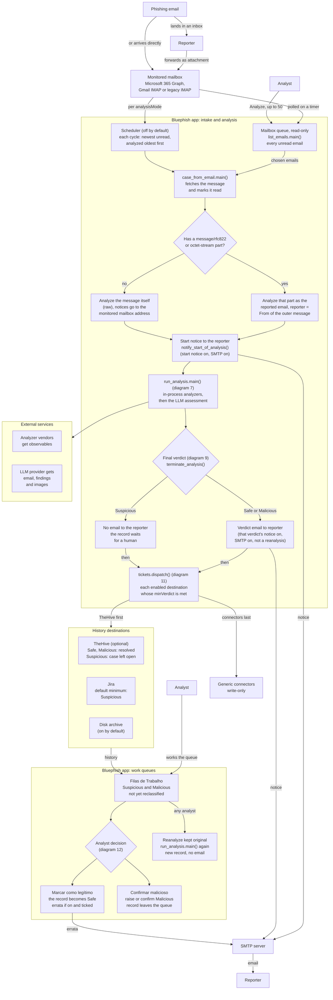

- **Layout.** The Bluephish app is drawn as two boxes, intake and analysis above and the work queues below, with the recording destinations between them. The Reporter and the Analyst are each drawn twice, at the top and at the bottom. That only keeps the arrows short: each pair is one actor. The monitored mailbox is Microsoft 365 (Graph), Gmail (IMAP) or a legacy IMAP section.
- **Two ways in, one fetch.** `case_from_email.main()` decides per message, not per setting. If the message has a message/rfc822 or application/octet-stream part, that part is analyzed as the reported email and the From of the outer message is the reporter. Otherwise the message itself is analyzed, and every notice goes to the monitored mailbox address. Mailing the verdict to the sender of a raw email would mean mailing it to the phisher.
- **The fetch decides by MIME type, the listing by content.** `obtain_eml()` accepts any application/octet-stream part without the libmagic check that `list_emails` applies. An email that arrived directly with an attachment its client labelled application/octet-stream (a .zip or a PDF sent that way, for example) is listed as a raw email. Analyzed by hand, though, it is treated as a forwarded report, and its sender becomes the reporter.
- **analysisMode only steers the Scheduler.** Every intervalMinutes the Scheduler downloads the newest pageSize (default 30) unread emails and analyzes up to maxPerCycle of them, oldest first. In `attachment` mode (Attached .eml) it takes only reports and skips raw emails, and on Gmail it narrows its search to unread mail with an attachment. In `raw` mode it takes every unread email. The analyst's queue, `list_emails.main(all_pending=True)`, always lists every unread email, and the analyst can analyze one of them or up to 50 selected. A report older than the pageSize window waits until newer mail is read. Keep the Scheduler off on a personal mailbox in raw mode ([§7.9](BLUEPHISH_ARCHITECTURE.md#79-operational-warning--automatic-analysis)).
- **Listing is not analyzing.** The queue is read-only, and opening a report only peeks at it ([diagram 5](#5-listing-the-mailbox)). The fetch at the start of an analysis is what marks the message as read and takes it out of everybody's queue.
- **Suspicious is the human state.** It is the only verdict that never emails the reporter and never resolves the TheHive case. Emails for Safe and Malicious need two switches, the per-verdict notice and the SMTP server, and the shipped configuration has both off. The start notice is `run_analysis.notify_start_of_analysis()`. A dead SMTP server logs a warning and never changes the verdict.
- **The verdict email goes out before the result is recorded.** `terminate_analysis()` sends it. Then `tickets.dispatch()` hands the report to each enabled destination whose `minVerdict` the verdict reaches, TheHive first, and `connectors.dispatch()` runs the generic connectors last. A destination that is down loses that one record and undoes nothing.
- **The disk archive is the only destination on by default** on a fresh installation; an installation that already had a TheHive key keeps TheHive on. TheHive, when on, resolves Safe and Malicious cases, leaves Suspicious open, and requests a MISP export for Malicious when one is configured ([diagram 11](#11-recording-destinations-and-history)).
- **The queues read from the destinations, not from TheHive alone** ([§4.8](BLUEPHISH_ARCHITECTURE.md#48-case-history-and-insights)). A record reaches Filas de Trabalho (the work queues) only if TheHive, disk or Jira recorded it. Generic connectors are write-only. A deployment that records only through connectors, or whose history destinations skip Suspicious, has an empty desk.
- **The analyst's later decision** ([§4.8.1](BLUEPHISH_ARCHITECTURE.md#481-why-a-verdict--and-an-analyst-disagreeing-with-it), [§7.16](BLUEPHISH_ARCHITECTURE.md#716-the-work-desk-queues-scope-and-the-errata)) is appended in the database and then written back to the destination. Marcar como legítimo turns a Malicious or Suspicious record into Safe. Only that false-positive correction can send the errata, only when the errata is enabled and the analyst ticks it, and the errata ships off. Confirmar malicioso raises a Suspicious record or confirms a Malicious one, and the record leaves the queue. A reanalysis is not a decision. Any analyst can run it. It runs the kept original through `case_from_email.main_from_eml()` and then `run_analysis.main(notify=False)`, writes a new record next to the old one, and emails nobody. [diagram 12](#12-after-the-verdict) covers scope, verdict memory and blocking.

Drawn from: `app/case_from_email.py` · `app/list_emails.py` · `app/email_provider.py` · `app/thephish_app.py` · `app/inbox_pages.py` · `app/run_analysis.py` · `app/mailer.py` · `docker/thephish_conf_files/configuration.json` · `docker/docker-compose.yml` · `app/tickets.py` · `app/connectors.py` · `app/templates/index.html`

## 2. Deployment (Docker Compose)

The stack as docker/docker-compose.yml declares it, plus the optional services from docker/docker-compose.integrations.yml. The only container analysis needs is thephish (image thephish-custom:latest, built from ubuntu:20.04 plus app/). It serves the Browser (BluePhish UI) over HTTPS with Socket.IO on 127.0.0.1:8080, using Flask + Flask-SocketIO on eventlet and a self-signed certificate generated on first start. In the same process it runs the Scheduler, the inbox poll and the queue loader as background greenlets. Three bind mounts hold what has to survive an image rebuild: the two live configuration files from thephish_conf_files/ and the data directory vol/thephish_data. TheHive and MISP sit beside it as optional services, and each box also names that service's own backing stores: cassandra for TheHive, mysql and redis for MISP. The browser itself loads the socket.io client and fonts from public CDNs (cdnjs, Google Fonts).

The analyzers run inside the Bluephish app (analyzers.py), and the verdict email goes out through mailer.py. That is why most arrows leave the stack, with nothing inside the stack in between. They go to the Monitored mailbox, the LLM provider and the Identity provider (Entra ID / OIDC), and one arrow goes to the stack of external services that only the app calls: analyzer vendors, hosts named in the reported email, SMTP, Jira, blocking destinations, syslog and generic connectors. The app never talks to MISP. For a Malicious case it asks TheHive to export.

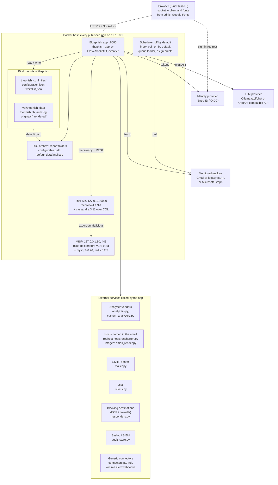

- **Solid arrows are network or file I/O. Dashed arrows are indirect or conditional.** The browser is redirected to Entra ID to sign in. The dashed 'default path' arrow from the bind mounts means the Disk archive sits inside the data mount (vol/thephish_data) only while it keeps its default path. The MISP export is done by TheHive's MispModule at the app's request: tickets.py create_thehive calls export_to_misp. That module ships commented out in docker/thehive/application.conf, yet the committed live configuration sets misp.id to 'MISP THP', so out of the box every Malicious case asks for an export and records that it failed. thephish still declares depends_on misp (next to depends_on thehive). Dropping MISP from the compose file therefore takes more than deleting three services.
- **Only configuration.json, whitelist.json and vol/thephish_data survive a rebuild.** Their paths are under docker/. The two config files are mounted one file at a time from thephish_conf_files/, and vol/thephish_data is mounted at /root/thephish/data. The app keeps users, history, the audit trail and evidence there: thephish.db (SQLite), auth.log, the TLS pair, originals/, rendered/ and volume_alerts.json. The code is COPYed into the image (app/Dockerfile), so a git pull needs docker compose build, not a restart. tickets.py writes the Disk archive's report folders. The Disk archive, the YARA rules and any other path you configure must stay under /root/thephish/data, or they disappear with the container layer. tickets.py warns about this when it probes the disk destination. configuration.json is written at runtime and marked skip-worktree ([§5.4](BLUEPHISH_ARCHITECTURE.md#54-configuration-files-and-secrets), [§7.8](BLUEPHISH_ARCHITECTURE.md#78-the-live-configuration-carries-real-secrets-and-is-skip-worktree)).
- **Nothing here needs a browser.** scheduler_loop, inbox_poll_loop and inbox_loader_loop start with the process (thephish_app.py __main__) as background greenlets. 'poll' is the inbox poll paging the queue. It is on by default, so the mailbox is read even when nobody is signed in, and that is what spends the provider's daily download budget ([§7.7.1](BLUEPHISH_ARCHITECTURE.md#771-the-daily-bandwidth-budget-is-a-trap-and-it-fails-as-a-connection-error), [diagram 5](#5-listing-the-mailbox)). 'fetch' is the app fetching a message to analyze. The Scheduler analyzes only after autoAnalysis is enabled, and it ships disabled.
- **host.docker.internal is not mapped by default.** The committed live configuration points the app's LLM at http://host.docker.internal:11434/api/chat. Where that name does not resolve on its own (Linux), add `extra_hosts: ["host.docker.internal:host-gateway"]` to thephish, as docker/README.md 'Where the app calls out to' says.
- **Inside the stack, use service names.** The app reaches TheHive at http://thehive:9000 with thehive4py and REST /api/v1/query. Inside a container, localhost is that container.
- **Compose details left out of the service boxes.** thehive runs thehiveproject/thehive4:4.1.9-1, has depends_on cassandra, and mounts thehive/application.conf, vol/data and vol/index. cassandra is internal and uses vol/cassandra-data. misp runs coolacid/misp-docker:core-v2.4.148a and has depends_on redis + mysql. mysql is internal and uses vol/mysql, and redis is internal.
- **What the short labels stand for.** 'tokens': the server does the OIDC code exchange (msal) and gets app tokens for Graph mail, the directory, EOP and MDTI. 'chat API' from the app covers llm_analysis.py (the analysis and the council's calls), thephish_app.ask_chat_llm() (the case chat and the audit assistant) and the model catalog in llm_catalog.py. The Monitored mailbox is Gmail IMAP at imap.gmail.com:993, a legacy IMAP host, or Microsoft Graph. The browser loads the socket.io 4.0.1 client from cdnjs and the fonts from Google Fonts.
- **The one arrow into 'External services called by the app' means one call per box**, made by the module named in that box. Analyzer vendors get HTTPS API calls: VirusTotal, AbuseIPDB, Safe Browsing, PhishTank, OpenPhish, URLhaus, OTX, Hybrid Analysis, MDTI and CrowdStrike, plus analyst-defined analyzers. Hosts named in the reported email are reached for shortener redirect hops and remote images. SMTP uses starttls 587, ssl 465 or none 25. Jira is called over REST. Block requests go to EOP, PAN-OS, FortiGate and Check Point. Syslog goes over udp or tcp, default port 514. Connectors use HTTP delivery, and that includes the volume alert webhooks.
- **Most outbound arrows that go to typed or attacker-chosen addresses pass the SSRF guard ([diagram 15](#15-ssrf-guard-chain)).** That covers analyst-defined analyzers, redirect hops, remote images, Jira, the firewall blocking destinations, syslog and connectors. The LLM endpoint, the built-in vendor APIs and EOP (fixed Microsoft hosts) are called with plain requests. TheHive's URL is validated when it is saved, but the calls then go through thehive4py and plain requests, without call-time revalidation or a pinned connection.
- **Analyzers run in process** on greenlets ([§4.9](BLUEPHISH_ARCHITECTURE.md#49-native-analyzers), [§7.1](BLUEPHISH_ARCHITECTURE.md#71-analyzer-concurrency-runs-on-greenlets-not-threads)). The verdict mail goes out over SMTP (mailer.py). [diagram 11](#11-recording-destinations-and-history) covers recording destinations and reading history back, and [diagram 10](#10-llm-analysis) covers the LLM path.

Drawn from: `docker/docker-compose.yml` · `docker/thehive/application.conf` · `app/thephish_app.py` · `app/generate_cert.py` · `app/static/assets/js/bluephish.js` · `app/templates/index.html` · `app/templates/login.html` · `app/models.py` · `app/auth.py` · `app/case_evidence.py` · `app/volume_alerts.py` · `app/tickets.py`

## 3. Application modules

This diagram shows the Python modules of app/, grouped by responsibility, and the import edges between the groups. Each edge stands for one or more imports from a module in the source group to a module in the target group, and its label names the entry point or the family of calls. thephish_app.py is the hub: it imports nearly every other module (thephish_app.py:30-70), so it gets one edge per group instead of forty. run_analysis.py is drawn on its own because, apart from the hub, it is the only module that joins the analysis pipeline, the LLM, the recording destinations and the verdict memory, and it joins them inside a single analysis. thephish_app.py only calls case_from_email.main() and then run_analysis.main().

Grouping keeps the picture readable; it does not mean the files of a group form one unit. The table under the diagram says what each module does and which module inside a group an edge lands on. pinned_http.py sits under six modules from four groups, because it is the connection half of the SSRF guard ([§4.5.1](BLUEPHISH_ARCHITECTURE.md#451-analyzers-the-analyst-defines)); the guard's own logic is in [diagram 15](#15-ssrf-guard-chain).

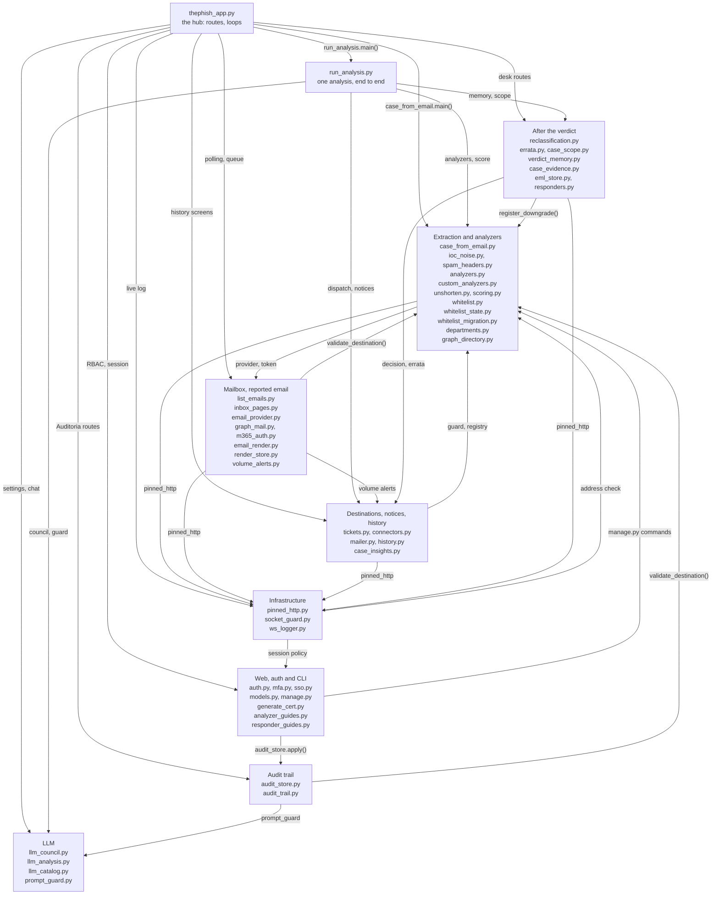

- **Read each edge from the importing group to the group it imports.** The label names the entry point or the family of routes, not every call; the table below says which module on each side the edge stands for.
- **The hub coordinates the after-verdict modules, and they do not import each other.** reclassification.py never imports errata.py or verdict_memory.py. The reclassify route in thephish_app.py first calls reclassification.record(). It then writes the decision back through tickets.reclassify_*(). Only for a false positive, and only if the analyst asks, it then calls errata.send() and verdict_memory.learn(). learn() is admin-only for the content and sender scopes (thephish_app.py:4697-4895). Reanalysis works the same way: case_evidence.fetch(), then case_from_email.main_from_eml(), then run_analysis.main() (thephish_app.py:4564-4586). [diagram 12](#12-after-the-verdict) shows that flow.
- **Every model call made during an analysis goes through llm_council.main(), single mode included** (llm_council.py:381-382). run_analysis.py imports llm_analysis.py but never calls it (the import is unused). The escalation thresholds come from the llm_analysis section of configuration.json, which run_analysis.main() reads itself. The two chats are the exception. The case chat and the audit assistant post to the provider themselves through thephish_app.ask_chat_llm(). From the LLM group they take only prompt_guard.py, the default system prompt and the request headers. prompt_guard.py sits under the pipeline, the council, the chats and the audit assistant. [diagram 10](#10-llm-analysis) covers the LLM.
- **history.py does not read TheHive or Jira.** select_cases() in thephish_app.py queries TheHive itself (thehive_cases()), because that needs a green pool and a query DSL. Jira comes through tickets.read_jira(), shaped by thephish_app.jira_cases(). Disk comes through history.disk_records(). Everything then goes to history.merge(). run_analysis.py also imports history.py, for history.record_id(). That call is why the refs that case_scope.record() and case_evidence.keep() store match the ids the history screens read back. [diagram 11](#11-recording-destinations-and-history) shows the sources.
- **The seven SSRF consumers are the edges into Infrastructure (pinned_http.py) and into Extraction and analyzers (custom_analyzers.py, where validate_destination() lives).** Six of them open the connection to the configured address through pinned_http.py: custom_analyzers.py, unshorten.py, email_render.py, tickets.py (Jira), connectors.py and responders.py. There are two exceptions. TheHive in tickets.py goes through thehive4py without pinning ([§4.5.1](BLUEPHISH_ARCHITECTURE.md#451-analyzers-the-analyst-defines)). responders.py reaches Entra ID and EOP directly, because those hosts are fixed in the code. audit_store.py calls validate_destination() and then hands the syslog handler the first address of a second lookup, which is not judged again — a known gap, to be fixed in code ([diagram 15](#15-ssrf-guard-chain), [§4.6.2](BLUEPHISH_ARCHITECTURE.md#462-where-the-trail-lives-and-how-long-it-stays-audit_storepy)). Every pinned consumer also calls validate_destination() itself before it connects; [diagram 15](#15-ssrf-guard-chain) draws those calls.
- **models.py has many importers:** thephish_app.py, auth.py, manage.py, sso.py, whitelist_state.py, case_scope.py, reclassification.py and verdict_memory.py. manage.py also imports analyzers.py, custom_analyzers.py, scoring.py and case_from_email.py inside individual commands. [diagram 13](#13-data-model) has the tables.
- **Some modules only work inside the image.** thephish_app.py and list_emails.py import eventlet and libmagic, which exist only in the container. inbox_pages.py stays plain Python on purpose, so the queue-paging rules can be tested outside the container (inbox_pages.py docstring; [§7.15](BLUEPHISH_ARCHITECTURE.md#715-the-application-keeps-the-original-message-eml_storepy) applies the same rule to eml_store.py). Keep new rule logic in modules like it.

| Module | What it does | Imports that the group edges stand for |
|---|---|---|
| thephish_app.py | routes, security config, scheduler, polling loops | nearly every module (the hub) |
| auth.py | login, RBAC decorators, session policy, audit() | mfa.py, sso.py, models.py, audit_store.apply() |
| mfa.py / sso.py | TOTP second factor, OIDC sign-in | models.py (sso.py) |
| models.py | SQLAlchemy tables | mfa.py |
| manage.py | CLI entrypoint | models.py; pipeline modules inside commands |
| generate_cert.py, analyzer_guides.py, responder_guides.py | TLS on first start, screen prose | only the hub imports them |
| list_emails.py / inbox_pages.py | listing, queue paging | email_provider.py, email_render.py |
| email_provider.py | GraphProvider / ImapProvider | graph_mail.py, m365_auth.py |
| email_render.py / render_store.py | as-delivered view | custom_analyzers.validate_destination(), pinned_http.py (email_render.py) |
| volume_alerts.py | alert on the unanalyzed queue | connectors.deliver(), mailer.send() |
| case_from_email.py | parse, observables, SPF/DKIM/DMARC | email_provider.create_provider(), whitelist.py / whitelist_state.py, ioc_noise.py, spam_headers.py |
| run_analysis.py | orchestration, verdict, recording | analyzers.run(), custom_analyzers.run(), unshorten.resolve(), scoring.compute(), whitelist, departments.resolve_from_file(), prompt_guard.inspect(), llm_council.main(), tickets.dispatch(), connectors.dispatch(), mailer.send(), history.record_id(), verdict_memory.apply(), case_scope.record(), case_evidence.keep() |
| analyzers.py | native analyzers | — |
| custom_analyzers.py | analyst-defined analyzers, validate_destination() | pinned_http.py |
| unshorten.py | redirect chains | pinned_http.py |
| scoring.py | weighted score | analyzers.py (the analyzer registry) |
| whitelist.py / whitelist_state.py / whitelist_migration.py | rules, counters, downgrade, migration | models.py (whitelist_state.py) |
| departments.py / graph_directory.py | reporter's department | m365_auth.get_access_token() (graph_directory.py) |
| llm_council.py | single / review / debate | llm_analysis.main() / chat(), prompt_guard.py |
| llm_analysis.py / llm_catalog.py | client, prompts, model catalog | llm_catalog.py, prompt_guard.py (llm_analysis.py) |
| prompt_guard.py | sanitize, spotlight, detect, verify | — |
| tickets.py | TheHive, Jira, disk | custom_analyzers.validate_destination(), analyzers.py, case_insights.py, pinned_http.py (Jira only) |
| connectors.py | generic connectors | tickets.report_as_markdown(), tickets.accepts_verdict(), custom_analyzers.validate_destination(), analyzers.py, pinned_http.py |
| mailer.py | SMTP reporter notices | — |
| history.py | record ids, disk records, merge, dedupe | case_insights.py |
| case_insights.py | dashboard aggregates | — |
| reclassification.py | analyst decision | case_insights.apply_decision() |
| errata.py | correction to the reporter | mailer.send() |
| case_scope.py | message fingerprints | models.py |
| verdict_memory.py | what a correction teaches | whitelist_state.register_downgrade() |
| case_evidence.py / eml_store.py | kept original message | eml_store.py (case_evidence.py) |
| responders.py | blocking destinations | pinned_http.py (firewalls) |
| audit_store.py | where the trail lives, syslog copy | custom_analyzers.validate_destination() |
| audit_trail.py | Auditoria screen, assistant | audit_store.trail_files(), prompt_guard.py |
| pinned_http.py | connection pinned to the validated IP | custom_analyzers address checks |
| socket_guard.py / ws_logger.py | WebSocket admission, live log | auth.session_policy_holds() (socket_guard.py) |

Drawn from: `app/thephish_app.py` · `app/auth.py` · `app/socket_guard.py` · `app/manage.py` · `app/audit_trail.py` · `app/list_emails.py` · `app/email_provider.py` · `app/case_from_email.py` · `app/volume_alerts.py` · `app/run_analysis.py` · `app/scoring.py` · `app/llm_council.py`

---

<!-- The analysis pipeline -->

## 4. Analysis of one reported email (sequence)

This diagram follows one reported email from the click, or the Scheduler tick, to the verdict on screen. The observables stay in memory in run_analysis.py from the first parse to the verdict. The analyzers call the vendors directly, and mailer.py answers the reporter over SMTP. TheHive is one of the destinations that tickets.dispatch() reaches, and only after the verdict.

Three entry points drawn here reach the same pipeline: POST /analysis (one email), POST /analysis-selected (a batch) and the Scheduler's run_automatic_analysis(). Each runs case_from_email.main() and then run_analysis.main(). A fourth, POST /api/cases/<case_ref>/reanalyze, starts from a kept original through case_from_email.main_from_eml() and calls run_analysis.main() with notify=False, so the reporter is never mailed ([diagram 12](#12-after-the-verdict)). Each stage has its own diagram: listing the mailbox in [diagram 5](#5-listing-the-mailbox), extraction in [diagram 6](#6-extracting-observables), the run/terminate/remember phase in [diagram 7](#7-running-the-analysis-and-closing-it), analyzers in [diagram 8](#8-choosing-and-running-analyzers), the verdict rules in [diagram 9](#9-verdict-decision-chain), the LLM in [diagram 10](#10-llm-analysis) and the destinations in [diagram 11](#11-recording-destinations-and-history).

The Bluephish app lifeline is thephish_app.py. Two lifelines stand for more than one system. Vendors and LLM is the Analyzer vendors (analyzers.py, custom_analyzers.py), which analyze_observables() calls, and the LLM provider, which llm_council.main() calls. Destinations is TheHive, Jira and the Disk archive, which tickets.dispatch() reaches, and the Generic connectors, which connectors.dispatch() reaches.

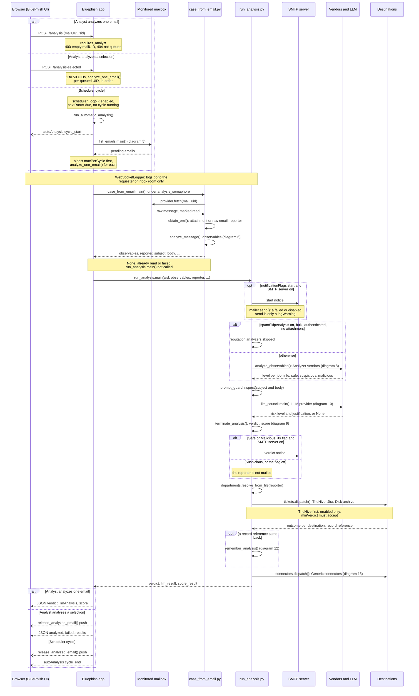

- **Entry gates.** POST /analysis sits behind requires_analyst. An empty mailUID answers 400, and a UID not in queued_mail_uids() answers 404. POST /analysis-selected takes 1 to 50 mailUIDs and the sid, and runs analyze_one_email() per UID, in order. UIDs no longer queued are skipped. For the Scheduler, nextRunAt follows intervalMinutes, and the listing is list_emails.main(limit = pageSize, newest first). From that listing it takes the oldest maxPerCycle. The autoAnalysis cycle_start event goes to the inbox room.
- **Logging.** WebSocketLogger sends each line as a Socket.IO logInfo, logWarning or logError event. It goes to the requesting socket of the same session (socket_guard.log_target) or, for the Scheduler, to the inbox room. With neither, the line is dropped. It is never broadcast.
- **Fetching the message claims it.** provider.fetch() in email_provider.py reads IMAP RFC822 or Graph MIME, and it marks the message as read. IMAP does that with FETCH RFC822, and Graph with an explicit PATCH isRead. A message that is already read comes back as None, which is how two tabs, or a tab and the Scheduler, avoid analyzing the same email twice ([§7.7](BLUEPHISH_ARCHITECTURE.md#77-imap-batch-fetching)). case_from_email.main() and the Scheduler's listing both run under analysis_semaphore, so the mailbox sees one session at a time ([§7.10](BLUEPHISH_ARCHITECTURE.md#710-mailbox-polling-and-lazy-body-loading)). The analyzers and the LLM run outside the semaphore.
- **What extraction hands back.** analyze_message() reads SPF/DKIM/DMARC, scans the bulk headers, and runs parse_eml and collect_observables ([diagram 6](#6-extracting-observables)). case_from_email.main(wsl, mail_uid) returns the observables, reporter, subject, body, auth results, images, eml_bytes and bulk signals. It returns None when the message was already read or the fetch or parse failed. In that case run_analysis.main() is not called: the single route answers null, and the batch and the Scheduler count a failure.
- **The notices go to whoever sent the message to the mailbox, not to the analyzed sender.** obtain_eml() makes that choice. When the message carries an attached message (a message/rfc822 part, or any application/octet-stream part), the attachment is analyzed and the reporter is the From of the mailbox email. When it carries none, the raw email itself is analyzed and the notices go to the monitored mailbox address. Sending them to the email's own sender would mean mailing the verdict to the phisher.
- **Each notice has two gates.** The per-event flag in notificationFlags has to be on, and so does the SMTP server section. Both notices go to the reporter through mailer.send(reporter, ...). The start notice's subject is '[BluePhish] Análise iniciada: subject', and the verdict notice's subject is '[BluePhish] Veredito: seguro / malicioso — subject'. When mailer.send() finds SMTP disabled, it returns a failure without opening a session, and that shows up only as a logWarning. A Suspicious verdict never mails the reporter.
- **The order is deliberate.** The reputation analyzers are skipped only when spamSkipAnalysis is on, the mail is bulk, the domain is authenticated and there is no attachment. Today that never happens: the reported message itself is always a `file_message/rfc822` observable, and the attachment test counts it as an attachment ([§1.2.2](BLUEPHISH_ARCHITECTURE.md#122-bulk-mail-and-the-spam-label-spam_headerspy)). Otherwise analyze_observables() unshortens, runs plan_jobs and run_jobs (up to 8 in parallel, with a 1 h cache), and each job returns one level. The analyzers finish before the LLM is called, so the model sees their findings. llm_council.main() receives the subject, body, auth results, analyzer findings and images, and returns None when the LLM is off or unreachable. prompt_guard runs before the model call and outside it, so an email carrying an injection payload is flagged even when the LLM is off ([§8.3](BLUEPHISH_ARCHITECTURE.md#83-prompt-injection-defences-prompt_guardpy)). terminate_analysis() applies the rules, score, whitelist and verdict memory to decide the verdict. The LLM can only raise it ([diagram 9](#9-verdict-decision-chain)).
- **Nothing after the verdict can change it.** departments.resolve_from_file(reporter) looks up the reporter's department in Entra ID via Graph and returns '' when the lookup is off or unreachable. The department lookup, every destination and every connector return a result instead of raising, so a TheHive, Jira or SMTP server that is down becomes a logWarning line. An unexpected error in the hand-off itself is caught too, but it is written only to the server log, and the destinations after it are skipped. Among the notices, only one can abort a run, and it comes earlier: an exception while sending the start-of-analysis notice returns None before any analyzer runs (so does a failure reading the configuration, in the analyzers or in terminate_analysis()). A failed send only logs.
- **TheHive goes first for a reason.** tickets.dispatch(report, eml, files) reaches only the enabled destinations whose minVerdict accepts the verdict. It sorts TheHive ahead of the others, so TheHive's case number fills caseRef before Jira, the Disk archive and the Generic connectors see the report. For a Malicious verdict, the TheHive destination asks TheHive to export to MISP when a MISP export name is set. The Bluephish app never talks to MISP itself. connectors.dispatch(report) then calls connectors.deliver() for each enabled Generic connector whose minVerdict accepts the verdict ([diagram 15](#15-ssrf-guard-chain), [diagram 11](#11-recording-destinations-and-history)). remember_analysis() needs a record reference. When it gets one, it calls case_scope.record and, if enabled, case_evidence.keep (eml_store), see [diagram 12](#12-after-the-verdict). With no destination enabled, nothing is fingerprinted or kept, so reanalysis and scope have nothing to find later ([§7.15](BLUEPHISH_ARCHITECTURE.md#715-the-application-keeps-the-original-message-eml_storepy), [§7.16](BLUEPHISH_ARCHITECTURE.md#716-the-work-desk-queues-scope-and-the-errata)).
- **Queue and failures.** run_analysis.main() returns three Nones only when the configuration, the start notice, the analyzers or terminate_analysis() failed. The single route then answers null instead of the verdict, llmAnalysis and score. In the batch and Scheduler paths, release_analyzed_email() drops the analyzed row from the polling snapshot and pushes the queue to every subscribed interface. The single-email path drops the row only in the requesting browser (drop_from_queue), and the snapshot catches up at the next listing. When a stage fails, it returns None up the chain, and the UI shows 'Falha na análise' with the reason in the log panel.

Drawn from: `app/thephish_app.py` · `app/socket_guard.py` · `app/static/assets/js/bluephish.js` · `app/ws_logger.py` · `app/case_from_email.py` · `app/email_provider.py` · `app/graph_mail.py` · `app/run_analysis.py` · `app/mailer.py` · `app/llm_council.py` · `app/departments.py` · `app/tickets.py`

## 5. Listing the mailbox

This diagram replaces the old list_emails_activity.png ("connect to IMAP, select unread emails with an EML attachment, build the list"). The analyst's queue is now built by three separate jobs. The listing is started by the polling cycle, or by GET /list when an analyst refreshes. It enumerates every unread message and downloads only page 1 at each end. The background loader then fills in the rest a page at a time. The analyst's click loads the email they want before the loader reaches it. None of the three marks a message as read. Opening an email is not analyzing it: only provider.fetch(), called by the analysis ([diagram 4](#4-analysis-of-one-reported-email-sequence), [diagram 6](#6-extracting-observables)), sets the Seen flag. The Scheduler reads the same mailbox through the same provider, but it takes one end only and never feeds the queue.

The pivot is inbox_hydrated. Every body the application holds goes back into the next listing as `have`, and the provider describes those messages from their envelope instead of downloading them again. Without it, a mailbox that has not changed is downloaded again every minute. On Gmail that used up the account's daily IMAP download budget by mid-afternoon ([§7.7.1](BLUEPHISH_ARCHITECTURE.md#771-the-daily-bandwidth-budget-is-a-trap-and-it-fails-as-a-connection-error)).

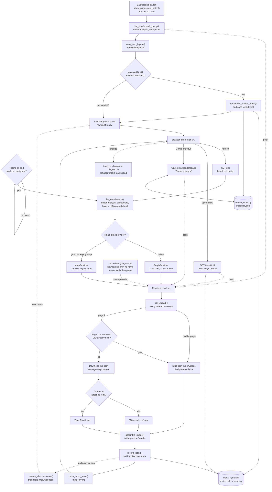

- **Held bodies feed the next listing.** Every UID in inbox_hydrated goes into the next list_emails.main() call as `have` — that is the loop that keeps an unchanged mailbox from being downloaded again ([§7.7.1](BLUEPHISH_ARCHITECTURE.md#771-the-daily-bandwidth-budget-is-a-trap-and-it-fails-as-a-connection-error)). The diagram shows it in the list_emails.main() label (have = UIDs already held) rather than as an arrow back from inbox_hydrated.
- **Four callers, one provider.** The polling cycle, GET /list (the refresh button), the background loader and the click routes all reach the mailbox through the provider that email_provider.create_provider() builds from `email_sync.provider`. That is GraphProvider for m365, with an app-only token from m365_auth.py (MSAL). Anything else gets ImapProvider (IMAP4_SSL), either on imap.gmail.com with an App Password or from the legacy `imap` section (basic or XOAUTH2). Every one of those reads holds analysis_semaphore, so a listing never opens a second IMAP session next to an analysis. Only the loader limits the lock to the mail-server trip and parses outside it. The poll, GET /list and the click routes parse under it, and a 'Como entregue' render with images also fetches those images under it. GET /list runs list_emails.main(all_pending=True, have) too, then record_listing() and the push, but no volume alert. It works with polling off, and with polling off it is the only thing that fills the queue.
- **The Scheduler is not a queue reader.** It calls list_emails.main(limit=pageSize, order newest) on the same provider, one end only, with no stubs and no `have`, because it analyzes what it downloads. On Gmail in attachment mode the search narrows server-side to `is:unread has:attachment`, and a message without an .eml is dropped, not listed as raw. Its listing never reaches record_listing(), inbox_hydrated or the browser ([diagram 4](#4-analysis-of-one-reported-email-sequence)).
- **Downloaded, envelope or held.** list_unread() enumerates every unread message up to ENVELOPE_MAX_MESSAGES (5000). Only page 1 at each end (`inboxPolling.pageSize`, 20/30/40/50, default 30) can arrive with a body; the rest is the middle. Everything else is a stub with `bodyLoaded: false`: IMAP builds stubs with one header fetch per 250 messages, before any body, and Graph from its envelope listing, 100 per page. Bodies are downloaded without marking the message read (IMAP `BODY.PEEK[]`, Graph message `$value`). A page-1 row whose UID is in `have` also comes back as a stub, and record_listing() lays the held copy back over it. It does so only when `receivedAt` matches, because IMAP sequence numbers get reused. This is the [§7.7.1](BLUEPHISH_ARCHITECTURE.md#771-the-daily-bandwidth-budget-is-a-trap-and-it-fails-as-a-connection-error) cure, and it is why inbox_hydrated is capped at the envelope backstop (5000) rather than at a cache size: an evicted body would be downloaded again on the next cycle. record_listing() also prunes the caches and render_store.py to the listing.
- **Hybrid listing and ordering.** The analyst's listing (`all_pending=True`) tags every parsed body in list_emails.retrieve_emails(). A message carrying a forwarded .eml becomes 'Attached .eml', with `attachedMail` and `attachedFrom` read from the inner message. Anything else becomes 'Raw Email', with those fields equal to its own subject and sender. assemble_queue() then orders the rows by the provider's `ids`, not by position. With `have`, a skipped body is a stub sitting inside the head, and concatenating head, stubs and tail would send a report the analyst was reading to the bottom.
- **The loader is what makes paging cheap** ([§7.10.1](BLUEPHISH_ARCHITECTURE.md#7101-the-queue-is-paged-and-loaded-a-page-at-a-time)). The chain from 'Background loader' to 'inboxProgress' is inbox_loader_loop(), which runs batch after batch. inbox_pages.page_plan() walks the pages alternating the front and back of the listing (newest end first with the default order), and next_batch() takes the earliest page with work, at most LOAD_BATCH (10) UIDs. It recomputes the plan every batch, so a new report at the top puts page 1 back first. ImapProvider.peek_many() reads the batch on one connection with an UNSEEN guard; GraphProvider peeks per message. A row counts as done only when it has both a body and a stored layout, so the page-1 rows the poll already downloaded are peeked once more to build their layout. The layout is built with `fetch_remote=False`, so no tracking pixel fires for an email nobody opened ([§7.11](BLUEPHISH_ARCHITECTURE.md#711-rendering-a-reported-email-as-it-was-delivered)). remember_loaded_email() stores the body only if the row had none yet, and the layout goes to render_store.py with layout_only=True. A row whose `receivedAt` no longer matches, or that cannot be read, goes into the loader's skip set. With no render_store (data/rendered cannot be opened or written, 1 GB cap) the loader stays idle and bodies load only on the click.
- **Opening is not analyzing.** GET /email/uid and GET /email-rendered/uid serve only UIDs in the current listing. GET /email/uid answers from the listing or inbox_hydrated, else list_emails.load_one() peeks the message. 'Como entregue' answers in two steps: first the stored layout with its remote images blocked, then `?images=1` runs list_emails.render_one() (peek plus email_render with remote images) and stores that copy over the layout. Both routes raise `inbox_loader['waiting']`, so a click waits behind at most the batch already in flight. Only the analysis calls provider.fetch(), which marks the message read and removes it from the next UNSEEN search. The batch and Scheduler paths then call release_analyzed_email(); after a single POST /analysis the browser drops the row and the next listing no longer has it.
- **Timings and limits.** With polling off or no mailbox, the cycle sleeps `intervalSeconds` and checks again; a failed read counts a failure, records nothing and still pushes, and the next sleep is `intervalSeconds` times the failure count, up to 5. The loader starts 15 s after boot, sleeps 5 s when render_store is closed, the queue is empty or no page has work, 60 s when the mailbox cannot be read, and 1 s between batches; while a click is waiting it checks every 0.2 s. The push resends rows only when the listing signature changes, with bodies cut to 500 characters, to the authenticated room.
- **The browser works on local state.** The order filter, search ([§7.12](BLUEPHISH_ARCHITECTURE.md#712-the-queue-search-filters-what-the-browser-already-has)) and page number never reach the server. The loader announces finished rows with small `inboxProgress` events.
- **Volume alerts are a side branch** ([§7.14](BLUEPHISH_ARCHITECTURE.md#714-volume-alerts-read-the-queue-never-the-mailbox-volume_alertspy)). evaluate_volume_alerts() runs after the polling cycle and after every loader batch that made rows ready, never after GET /list. It counts only rows whose body is loaded, saves the cooldown first and downloads nothing. volume_alerts.fire() runs in a background task outside the semaphore; mail goes through mailer.send() and webhooks through connectors.deliver(), which passes the SSRF guard ([diagram 15](#15-ssrf-guard-chain)).

Drawn from: `app/thephish_app.py` · `app/static/assets/js/bluephish.js` · `app/inbox_pages.py` · `app/email_provider.py` · `app/graph_mail.py` · `app/m365_auth.py` · `app/list_emails.py` · `app/render_store.py` · `app/email_render.py` · `app/case_from_email.py` · `app/volume_alerts.py`

## 6. Extracting observables

This diagram covers what case_from_email.py does between "an analyst or the Scheduler picked a message" and "run_analysis.main() receives the observables". The module has two entry points. case_from_email.main() fetches the message from the Monitored mailbox. case_from_email.main_from_eml() re-analyses a case from the reported message that the app kept ([§7.15](BLUEPHISH_ARCHITECTURE.md#715-the-application-keeps-the-original-message-eml_storepy)). Both meet in analyze_message(). That function reads the sender authentication, scans the bulk-mail headers, parses the message and flattens everything into one in-memory list of observables.

The module's name is historical: **this stage creates no case and never calls TheHive**. collect_observables() keeps the list in memory with local ids, and the analysis reads it from there. run_analysis.py records the finished analysis afterwards, through tickets.dispatch() ([diagram 7](#7-running-the-analysis-and-closing-it), [diagram 11](#11-recording-destinations-and-history)).

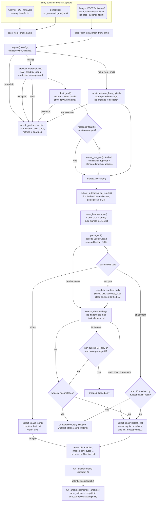

- **No case is created here.** Nothing in case_from_email.py imports or calls TheHive. The observable ids are local (obs-N), and the analyzer jobs are keyed to them ([diagram 8](#8-choosing-and-running-analyzers)). TheHive is one of the recording destinations, and run_analysis.py writes to them only after the verdict ([diagram 11](#11-recording-destinations-and-history)). The dotted edge is where the app keeps its own copy of the reported message ([§7.15](BLUEPHISH_ARCHITECTURE.md#715-the-application-keeps-the-original-message-eml_storepy)). That copy is made only once tickets.dispatch() has returned a record reference from a destination, and only while caseEvidence.storeOriginal is on (default on). The destinations may store the message too (Disk writeEml, Jira attachEml, see [diagram 11](#11-recording-destinations-and-history)).
- **Entry points.** Every entry runs under analysis_semaphore. The batch route POST /analysis-selected and the Scheduler's run_automatic_analysis() both go through analyze_one_email(). Like POST /analysis, they call case_from_email.main(wsl, mail_uid). The reanalysis route passes the bytes from case_evidence.fetch() to case_from_email.main_from_eml(wsl, eml_bytes, reporter), which parses them with email.message_from_bytes(eml_bytes).
- **Where the extraction stops.** prepare() reads logging_conf.json and configuration.json, then calls email_provider.create_provider() and whitelist.load(). 'setup fails' means a config file is unreadable, or main() is left without a provider. Every stop logs the error and emits it to the socket (a broken logging_conf.json is only printed), then returns None: the caller stops and nothing is analyzed. provider.fetch() raises on a connection error or timeout ('exception'). It returns None when another analysis already read the message, or when the message was not found. On IMAP it does an RFC822 fetch of an unread UID. IMAP and Graph both mark the message read.
- **Attachment or raw is decided per message, not by analysisMode.** obtain_eml() takes the reporter from the From header of the forwarding email. main() takes the first message/rfc822 or application/octet-stream part as the reported message. Only when there is no such part does it analyse the fetched message itself (obtain_raw_eml()). In that case the notices go to the Monitored mailbox, never to the sender, who would be the phisher. An octet-stream part is not checked: the listing tests it with libmagic ([diagram 5](#5-listing-the-mailbox)), the extraction does not. prepare() reads analysisMode, but main() never uses it; the setting only decides what the Scheduler lists ([diagram 5](#5-listing-the-mailbox)).
- **Reanalysis never looks for an attached .eml.** The bytes it gets are already the reported message. If it searched them, it would analyse whatever .eml the attacker put inside their own email ([§7.16](BLUEPHISH_ARCHITECTURE.md#716-the-work-desk-queues-scope-and-the-errata)). prepare() tolerates a missing provider, so a broken mailbox configuration does not block reanalysis. The route refuses before extraction when the archive is off or the original is gone.
- **Sender authentication trusts only the receiving server.** Only the FIRST Authentication-Results header is read, because later ones travelled with the message and can be forged. extract_authentication_results() yields spf, dkim, dmarc, aligned and authenticated. SPF alone never makes a message 'authenticated'. The bulk-header scan (spam_headers.scan() plus one_click_signed()) yields bulk_signals: a signal, never a verdict. A failure in the authentication read or in the bulk-header scan logs a warning, and the analysis continues. A failure in parse_eml() or collect_observables() stops it, as does an exception while fetching or unwrapping the message.
- **Here the whitelist can suppress only domain, URL, IP and attachment hash.** search_observables(buffer) runs on each header value and on the body text, and checks ip, domain and url with match_ip / match_domain / match_url. Attachment hashes are checked with ruleset.match_hash. Mail addresses are always kept, because sender trust is a downgrade applied at the verdict (match_sender, [diagram 9](#9-verdict-decision-chain)). A broken whitelist file loads as an empty ruleset: nothing is suppressed, and the analysis still runs. Every suppression counts as a use of its rule (record_match). The observables seen come back as a snapshot, not in a global, and feed the rule dry-run.
- **Two drops happen before the whitelist and cannot be configured.** The diagram draws them as one decision: the IP test applies to ip, the package test to domain. Non-routable IPs never leave the host. A Google Play package id such as com.linkedin.android is dropped when that name appears nowhere else in the text (ioc_noise.is_app_package_only() in ioc_noise.py, [§1.2.3](BLUEPHISH_ARCHITECTURE.md#123-false-positives-on-legitimate-brand-mail--measured-and-what-closes-them)).
- **The image and attachment branches are not exclusive.** parse_eml() reads 15 header fields (From, Reply-To, Received ...), then walks each MIME part of the reported email. Every image part goes to collect_image_part() first, and then through the disposition check like any other part. collect_image_part() keeps images of at least 8 KB each, at most 3 images and 4 MB in total, and skips a whitelisted sha256. Only text/plain and text/html parts that are not attachments become body text, and only attachments with a filename are hashed. An attached image is therefore both sent to the vision step and recorded as file and hash observables.
- **The reported message itself is always an observable** (file_message/rfc822), and only YARA judges it. collect_observables() gives each entry an id obs-N, a type, name, tags, content and ioc false; the types also include file and hash. analyze_message(wsl, internal_msg, reporter) returns observables, reporter, subject, body, auth_results, images, eml_bytes, observables_seen and bulk_signals. eml_bytes holds the same bytes as that observable, re-serialized by parse_eml() rather than kept as the forwarding envelope. Every extraction yields this observable, so the attachment test that should exempt only real attachments from spamSkipAnalysis always matches. [§1.2.2](BLUEPHISH_ARCHITECTURE.md#122-bulk-mail-and-the-spam-label-spam_headerspy) documents this gap and the fix (exclude that type from the test).

Drawn from: `app/thephish_app.py` · `app/case_from_email.py` · `app/whitelist.py` · `app/email_provider.py` · `app/graph_mail.py` · `app/list_emails.py` · `app/spam_headers.py` · `app/ioc_noise.py` · `app/whitelist_state.py` · `app/analyzers.py` · `app/custom_analyzers.py` · `app/run_analysis.py`

## 7. Running the analysis and closing it

This diagram follows what run_analysis.main() does with the observables case_from_email.py hands over ([diagram 6](#6-extracting-observables)), in the order the code runs it. It sets up, sends the start-of-analysis notice and runs the analyzers ([diagram 8](#8-choosing-and-running-analyzers)). Then come the LLM assessment ([diagram 10](#10-llm-analysis)) and terminate_analysis(), whose verdict rules are in [diagram 9](#9-verdict-decision-chain). After that it records the result in every enabled destination ([diagram 11](#11-recording-destinations-and-history)) and remembers the analysis for later reanalysis and scope counts ([diagram 12](#12-after-the-verdict)). The analyzers run in-process, the notices go out over SMTP through mailer.py, and closing the case is up to the TheHive destination in tickets.py.

The order matters for one reason: the verdict and the verdict email to the Reporter are both settled before any destination is contacted. The rule in this module is that nothing after the verdict can change the verdict or bring the analysis down. A destination that fails, a department lookup that fails and an original that can't be stored each end up as a warning in the log. A fingerprint the database refuses is dropped by case_scope.record(), which never raises. None of them ever becomes a failed analysis.

```mermaid
flowchart TD
  S("Scheduler, Analyst,<br/>or reanalysis (notify off)")
  subgraph SETUP["Setup"]
    CFG{"Config files<br/>readable?"}
    WL["whitelist.load()<br/>error: empty ruleset"]
  end
  subgraph NOTIFY["Notify start of analysis"]
    N1{"notify and<br/>start flag on?"}
    N2["send_notification()<br/>mailer.py, SMTP server"]
  end
  subgraph ANALYZE["Analyze observables"]
    SK{"spamSkipAnalysis<br/>conditions hold?"}
    AO["analyze_observables()<br/>in-process, see diagram 8"]
    SKIP["reputation lookups<br/>skipped"]
  end
  subgraph LLMSTEP["LLM analysis"]
    PG["prompt_guard.inspect()<br/>subject and body"]
    LC["llm_council.main(), diagram 10<br/>None when off or down"]
    FP["case_scope.fingerprint()<br/>message keys, once"]
  end
  subgraph TERM["Terminate analysis"]
    TA["terminate_analysis()<br/>ordered rules, see diagram 9"]
    V{"verdict?"}
    NF{"notify and that<br/>verdict's flag on?"}
    NM["verdict email to<br/>the Reporter via SMTP"]
    NN["no email to<br/>the Reporter"]
  end
  subgraph RECORD["Record the result, see diagram 11"]
    DEP["departments.resolve_from_file()<br/>empty on failure"]
    BR["tickets.build_report()"]
    DI["tickets.dispatch()<br/>enabled, minVerdict met,<br/>TheHive first"]
    TH["TheHive case<br/>Safe, Malicious resolved<br/>Suspicious left open"]
    JD["Jira issue /<br/>Disk archive folder"]
    DF["failed or refused:<br/>warning, others run"]
    RR["record_reference()"]
  end
  subgraph REMEMBER["Remember the analysis, see diagram 12"]
    RA{"any record<br/>reference?"}
    CS["case_scope.record()"]
    CE["case_evidence.keep()<br/>original .eml"]
    CW["nothing kept:<br/>warning"]
  end
  GC["connectors.dispatch()<br/>Generic connectors"]
  RET("return verdict,<br/>llm_result, score_result")
  ABORT("return None, None, None<br/>no verdict")

  S --> CFG
  CFG -->|"no"| ABORT
  CFG -->|"yes"| WL
  WL --> N1
  N1 -->|"yes"| N2
  N1 -->|"no"| SK
  N2 -->|"sent or warning"| SK
  N2 -.->|"exception"| ABORT
  SK -->|"yes"| SKIP
  SK -->|"no"| AO
  AO -.->|"exception"| ABORT
  AO --> PG
  SKIP --> PG
  PG --> LC
  LC --> FP
  FP --> TA
  TA -.->|"exception"| ABORT
  TA --> V
  V -->|"Suspicious"| NN
  V -->|"Safe or Malicious"| NF
  NF -->|"yes"| NM
  NF -->|"no"| NN
  NM -->|"sent or warning"| DEP
  NN --> DEP
  DEP --> BR
  BR --> DI
  DI --> TH
  DI --> JD
  DI --> DF
  TH --> RR
  JD --> RR
  RR --> RA
  DF --> RA
  RA -->|"yes"| CS
  RA -->|"no"| GC
  CS --> CE
  CE -->|"kept, or not needed"| GC
  CE -->|"eml present,<br/>nothing kept"| CW
  CW --> GC
  DI -.->|"unexpected exception"| RET
  GC --> RET
```

- **Dotted edges are the failures the code catches explicitly.** An exception while reading the configuration (logging_conf.json and configuration.json), sending the start notice, running the analyzers or in terminate_analysis() aborts the run with (None, None, None), and the caller shows no verdict. Two steps fall back with a warning instead of aborting. If the spamSkipAnalysis read fails, the analyzers run. If the message fingerprint fails, the keys stay empty and verdict memory is skipped. whitelist.load() and llm_council.main() sit outside any try and rely on their own never-raise contracts; on a load error the ruleset is empty and nothing is released. After the verdict, one try block covers building the report, dispatching to the destinations, remembering the analysis and the connectors. An exception there logs a warning and the verdict is still returned.
- **main() wraps remember_analysis() in a nested try.** A failure there can cost the scope row, the stored original and the reanalysis link-back (produced['recordRefs']), but never the generic connectors.
- **The Reporter hears the verdict before anything is recorded.** The verdict email goes out inside terminate_analysis(), before tickets.dispatch(). Suspicious never mails the Reporter, because it is the "a human decides" state ([§1.2](BLUEPHISH_ARCHITECTURE.md#12-verdict-logic)). A reanalysis (notify=False) sends no email at all, neither the start notice nor the verdict. Each notice also has its own switch (mailer.notification_flags: start, safe, malicious). Even then, mailer.send() refuses when the SMTP server switch is off, no sender is configured or the reporter address is invalid, and it returns an error on any SMTP failure. It never raises. Each refusal is a warning, and the attempt is still kept in sent_notifications with sent=false; run_analysis.main() then puts the notifications sent, the score and the bulk signals on the report that tickets.build_report() returned.
- **Closing the case belongs to the TheHive destination, not this module.** tickets.create_thehive() builds a case with the observables and the analysis log, resolves Safe as FalsePositive and Malicious as TruePositive, and leaves Suspicious open for the analyst. For Malicious, and only when a MISP export name (mispId) is configured, it asks TheHive to export the case to MISP. The app never talks to MISP directly. An export that TheHive answers with an error, or a resolve that fails, is noted in the destination's detail line and still counts as ok; a task-log write that fails is skipped silently. An export that raises (TheHive unreachable) fails the whole destination, with no case reference, even though the case was already created. Jira and Disk archive only record the report, and they have no open or closed state for this flow to set.
- **TheHive goes first because it assigns the case number.** tickets.dispatch() sorts TheHive ahead of the others and copies its reference into the report's caseRef. That way a Jira issue, a Disk archive folder and any generic connector carrying {{caseRef}} all point at the same case. The generic connectors run last, after the native destinations, for the same reason ([diagram 11](#11-recording-destinations-and-history), docs/conectores-genericos.md).
- **A destination that fails doesn't stop the others.** tickets.create() and connectors.deliver() never raise, and each result becomes an info line or a warning line. A destination that is off, or whose minVerdict is above the verdict, is simply skipped.
- **Remembering needs a record reference.** record_reference() turns each result into the TheHive case number (or id), jira:KEY or disk: plus the folder name — not the full path, because that is how history.py finds it. With no reference (no destination enabled, or every one failed), remember_analysis() does nothing: no scope fingerprint and no stored original, so the case can't be reanalyzed later ([§7.15](BLUEPHISH_ARCHITECTURE.md#715-the-application-keeps-the-original-message-eml_storepy), [§7.16](BLUEPHISH_ARCHITECTURE.md#716-the-work-desk-queues-scope-and-the-errata)). case_scope.record() writes one AnalysisFingerprint per reference, filed under report_of on a reanalysis. case_evidence.keep() stores the original .eml in eml_store under each reference. The run continues to the connectors when the original was kept under at least one reference, when the archive is off, or when there is no .eml; when an .eml was present but nothing could be kept while storeOriginal is on, it logs a warning, and reanalysis of that case will not work.
- **The message keys are computed once, before the verdict.** case_scope.fingerprint() runs ahead of terminate_analysis(). The same keys are used for the verdict-memory lookup ([§7.17](BLUEPHISH_ARCHITECTURE.md#717-verdict-memory--what-a-correction-teaches-verdict_memorypy)) and passed on to case_scope.record(). If they were computed in two places, the memory would silently never match. prompt_guard.inspect() measures injection findings without the model, so they count even when the LLM is off ([§8.3](BLUEPHISH_ARCHITECTURE.md#83-prompt-injection-defences-prompt_guardpy)).
- **spamSkipAnalysis** is the only switch meant to make the analysis skip looking at something. It is off by default and applies only when bulk mail, an authenticated domain and no attachment all hold together; the LLM assessment still runs when it is on. **Today it never skips:** the reported message itself is always a `file_message/rfc822` observable, and the attachment test counts it ([§1.2.2](BLUEPHISH_ARCHITECTURE.md#122-bulk-mail-and-the-spam-label-spam_headerspy)).

Drawn from: `app/thephish_app.py` · `app/run_analysis.py` · `app/mailer.py` · `app/scoring.py` · `app/llm_council.py` · `app/departments.py` · `app/tickets.py` · `app/history.py` · `app/case_evidence.py` · `app/case_scope.py` · `app/connectors.py`

## 8. Choosing and running analyzers

This diagram shows what happens inside run_analysis.analyze_observables(). It starts from the observable list that case_from_email.py produced ([diagram 6](#6-extracting-observables)) and ends with the report rows that terminate_analysis() turns into a verdict ([diagram 9](#9-verdict-decision-chain)). The analyzers run inside the Bluephish app, and each one calls its vendor directly. unshorten.py follows redirects. The twelve built-in analyzers in analyzers.py are eleven vendor lookups plus local YARA, and analyst-defined analyzers go through custom_analyzers.py. Every analyzer, native or custom, returns the same four-level contract: info, safe, suspicious, malicious ([§4.9](BLUEPHISH_ARCHITECTURE.md#49-native-analyzers), [§4.5.1](BLUEPHISH_ARCHITECTURE.md#451-analyzers-the-analyst-defines)).

The work runs in three steps, each drawn as a box. Step 1 follows the redirects of every URL, so a destination can be planned along with the other observables. Step 2, run_analysis.plan_jobs(), pairs each observable with each analyzer that is enabled and allowed to receive that type. Step 3, run_analysis.run_jobs(), runs the jobs on a green pool of 8. An analyzer that could not look always reports info with the reason attached, never safe ([§7.6](BLUEPHISH_ARCHITECTURE.md#76-an-analyzer-that-reports-nothing-is-not-an-analyzer-that-says-safe)).

```mermaid
flowchart TD
    START("run_analysis.main() calls<br/>analyze_observables() - diagram 7")
    CFG["Read settings once per analysis:<br/>analyzers.load_config(),<br/>custom_analyzers.load_all()"]
    subgraph S_UNSHORT["Step 1 - redirects of every URL"]
        direction TB
        U1{"Another url observable<br/>in the list as it was<br/>before Step 1?"}
        U2["unshorten.resolve(): HEAD first,<br/>up to 10 hops, pinned connection,<br/>each via validate_destination()"]
        U3{"Chain ended on a URL<br/>other than the original?"}
        U4{"Final URL matches<br/>the whitelist?"}
        U5{"Already a url<br/>observable?"}
        U6["Append a new url observable,<br/>tag unshortened_url"]
        U1 -->|"yes"| U2 --> U3
        U3 -->|"no"| U1
        U3 -->|"yes"| U4
        U4 -->|"yes: match recorded"| U1
        U4 -->|"no"| U5
        U5 -->|"yes"| U1
        U5 -->|"no"| U6 --> U1
    end
    subgraph S_PLAN["Step 2 - plan_jobs(), every pair"]
        direction TB
        N1{"Native: enabled, and<br/>analyzers.sends()<br/>the base type?"}
        C1{"Custom: enabled, and<br/>the saved definition<br/>lists the base type?"}
        JOB["Planned job: observable,<br/>kind, id, name"]
        DROP["Pair not planned:<br/>no report, no error"]
        N1 -->|"yes"| JOB
        N1 -->|"no"| DROP
        C1 -->|"yes"| JOB
        C1 -->|"no"| DROP
    end
    EMPTY{"Plan empty?"}
    WARN["Warn: no analyzer applies,<br/>the verdict rests on the LLM<br/>assessment and the diagram 9 floors"]
    FILES["write_file_observable(): only<br/>the attachments a planned job<br/>needs, to a per-analysis temp dir"]
    subgraph S_RUN["Step 3 - run_jobs(): pool of 8"]
        direction TB
        RJ["run_job() in a greenlet"]
        FILEP{"File observable whose<br/>attachment was not written?"}
        CK{"Fresh cache entry for<br/>kind, id, type, value?"}
        KIND{"Job kind?"}
        NAT["analyzers.run(): the vendor<br/>client returns a signal, then<br/>level_for() applies thresholds"]
        CUS["custom_analyzers.run(): URL<br/>revalidated, pinned, no redirects<br/>(diagram 15), value map gives the level"]
        FAIL{"Client raised?"}
        INFOE["Level info plus the reason:<br/>it did not look, never safe"]
        LEV["Level safe, suspicious or<br/>malicious, or info when<br/>the vendor has no data"]
        PUT["cache_put(): keeps only<br/>reports without error"]
        RETRY{"Report retryable and<br/>fewer than 3 retries?"}
        WAIT["Requeue the job, sleep 60 s,<br/>run a new pool round"]
        REP["Report row: observable_id,<br/>analyzer_id, analyzer_result,<br/>analyzer_detail, analyzer_error"]
        RJ --> FILEP
        FILEP -->|"no"| CK
        FILEP -->|"yes: info"| RETRY
        CK -->|"miss"| KIND
        CK -->|"hit: cached copy"| RETRY
        KIND -->|"native"| NAT
        KIND -->|"custom"| CUS
        NAT --> FAIL
        CUS --> FAIL
        FAIL -->|"yes"| INFOE
        FAIL -->|"no"| LEV
        INFOE --> PUT
        LEV --> PUT
        PUT --> RETRY
        RETRY -->|"no"| REP
        RETRY -->|"yes: never today"| WAIT --> RJ
    end
    CLEAN["Delete the temp dir, return<br/>reports_observables to main(),<br/>verdict in diagram 9"]

    START --> CFG --> S_UNSHORT
    S_UNSHORT -->|"no more URLs"| S_PLAN
    S_PLAN --> EMPTY
    EMPTY -->|"yes"| WARN --> FILES
    EMPTY -->|"no"| FILES
    FILES --> S_RUN
    S_RUN -->|"all jobs reported"| CLEAN
```

- **Each step is a box.** Step 1 is left when its first question finds no url observable left ("no more URLs"). Step 2 checks every observable against every analyzer. Step 3 is left once every job has a report row ("all jobs reported").
- **Step 1 only adds observables, and it runs before planning.** There is no shortener list. Every `url` observable gets a HEAD request from the container, which also tells the sender that someone looked. unshorten.resolve() sends a GET only if HEAD is refused and never reads the body. It follows up to 10 hops on a pinned connection, and validate_destination() checks the first URL and every hop ([diagram 15](#15-ssrf-guard-chain)). A URL that does not redirect ends its chain with `found = False`. The loop walks a copy of the list taken before it starts (`list(observables)`), so a resolved destination is planned like any other URL but is not followed again. The original URL stays in the list and is analyzed too. A destination that matches the whitelist is not added (the rule match is recorded), because allowing the shortener does not allow where it points. If a hop is refused or times out, the chain stops at the last approved URL, and that URL is still added when it differs from the original. unshorten.py is one of the seven consumers of the SSRF guard, and it never allows the internal network ([diagram 15](#15-ssrf-guard-chain)).
- **What gets sent depends on two settings, not one.** analyzers.supports() says what a vendor can judge: the registry types. analyzers.sends() narrows that to the types the admin chose to send it (Integrações → Analisadores), that is, the registry types minus the types the admin unticked. Both compare the base type, so the forwarded `file_message/rfc822` counts as `file` and only YARA receives it. No native analyzer accepts `mail`, so only a custom analyzer can judge an email address. A custom analyzer can never be saved with `file`. That check lives in validate_definition(), at save time, not in plan_jobs().
- **An empty plan is a warning, not an error.** Without reputation evidence, the verdict rests on the LLM assessment and the injection, council and coverage floors ([diagram 9](#9-verdict-decision-chain)). A separate case: run_analysis.main() skips this whole function for authenticated bulk mail without attachments when `spamSkipAnalysis` is on. Today that never happens: the reported message itself is always a `file_message/rfc822` observable, and the attachment test counts it as an attachment ([§1.2.2](BLUEPHISH_ARCHITECTURE.md#122-bulk-mail-and-the-spam-label-spam_headerspy)). That decision is shown in [diagram 7](#7-running-the-analysis-and-closing-it).
- **info vs safe.** Every client failure comes back as `info`, with the reason in `analyzer_error`. That covers a refused key, a quota or a 429, a timeout, an unexpected answer, a vendor that is down, and a guard refusal on a custom analyzer. Some real answers also map to `info`, because nobody actually looked: VirusTotal with zero engines, PhishTank not in its database, a sandbox with no report, MDTI with no classification and a score under the thresholds, and a custom value outside the map (`fallbackLevel`, `info` by default). [diagram 9](#9-verdict-decision-chain) and [§7.6](BLUEPHISH_ARCHITECTURE.md#76-an-analyzer-that-reports-nothing-is-not-an-analyzer-that-says-safe) cover what `info` means for the verdict, including the coverage floor.
- **The 429 retry loop is wired but never fires.** run_jobs() requeues a report only when `retryable` is set, for up to 3 rounds 60 s apart (the branch marked "yes: never today"). But analyzers.run() catches `RateLimited` together with every other `AnalyzerError` and never sets `retryable`, and a custom analyzer's 429 is a plain `AnalyzerError`. So a rate-limited lookup is recorded as `info` with the vendor's message. Reports that carry an error are not cached, so the next analysis asks the vendor again. [§4.9](BLUEPHISH_ARCHITECTURE.md#49-native-analyzers) documents the same gap.
- **Concurrency is greenlets, not threads.** run_jobs() runs the jobs on an eventlet.GreenPool of MAX_PARALLEL_ANALYSES = 8. The pool of 8 is there to respect free API tiers ([§7.1](BLUEPHISH_ARCHITECTURE.md#71-analyzer-concurrency-runs-on-greenlets-not-threads)). YARA is the one blocking call. It runs through analyzers.run_off_hub(), which uses eventlet.tpool, a real OS thread, so compiling the rules and scanning an attachment do not freeze the whole process. If a greenlet crashes, run_jobs() still turns it into an `info` row.
- **The cache exists for phishing campaigns.** Dozens of reports of the same email within minutes would otherwise repeat the same vendor queries, exactly when free quotas run out. The key is (kind, analyzer id, type, value). run_analysis.cache_put() keeps only reports without an error, with a TTL of 3600 s and at most 5000 entries. Files are never cached, because their value is a temporary path. A cached report keeps the level it was given, so a threshold change reaches a cached observable only when its entry expires, at most an hour later. Disabling an analyzer or unticking a type takes effect at once, because planning happens before the cache is consulted. OpenPhish also keeps its whole feed in the process for 900 s.
- **Attachments exist only during the run.** run_analysis.write_file_observable() writes an attachment only when a planned file job needs it, using `os.path.basename` of its attacker-chosen name. A file job whose attachment was not written reports `info` without calling the analyzer. The temp dir is deleted in a `finally` block.

Drawn from: `app/run_analysis.py` · `app/unshorten.py` · `app/custom_analyzers.py` · `app/analyzers.py`

## 9. Verdict decision chain

The ordered rules run_analysis.terminate_analysis() applies to turn analyzer results, the LLM assessment and the header signals into one verdict, in the order the code runs them. Its inputs are the analyzer results, the LLM result, the authentication results, the bulk signals, the prompt-injection findings and the message's content key. Every step before the whitelist can only raise the verdict. The last two steps, the whitelist and the verdict memory, are the only ones that can lower it. Both are counted, and both can suspend themselves. The verdict names are the code's own spelling: Safe, Suspicious, Malicious.

The order is fixed by design. The escalations (LLM, prompt-injection floor, AI council floor, coverage floor) run before scoring.compute() because the score takes the current verdict as its floor. If one ran afterwards, the screen could show 'Suspicious · 12'. The whitelist and the verdict memory run last because a demotion that happens after the full analysis leaves something to count. A bypass at the start of the pipeline would leave nothing to count, so a compromised account with valid DKIM would never show up. After the chain, whitelist_state.record_analysis() stores the analyzer verdict and the final verdict, and the reporter is notified unless the verdict is Suspicious, the run is a reanalysis or notification for that verdict is off. How the verdict then reaches the reporter and the destinations is [diagram 7](#7-running-the-analysis-and-closing-it). The LLM and council internals are [diagram 10](#10-llm-analysis). Analyst reclassification, which creates verdict memories, is [diagram 12](#12-after-the-verdict).

```mermaid
flowchart TD
  START["run_analysis.terminate_analysis()<br/>inputs: analyzer, LLM, auth,<br/>bulk, injection, content key"]
  BASE["1. Analyzer baseline<br/>malicious result: Malicious<br/>suspicious: Suspicious, else Safe"]
  LLM0{"2. LLM detected social engineering<br/>and verdict Safe or Suspicious?"}
  LLM1{"2a. risk ≥ malicious_escalation?"}
  LLM1G{"council trusts autonomous action<br/>AND sender domain<br/>not authenticated?"}
  MAL1("Malicious (autonomous)")
  LLM2{"2b. verdict Suspicious<br/>and risk ≥ High?"}
  MAL2("Malicious (combined signal)")
  LLM3{"2c. verdict Safe and risk ≥<br/>escalation_threshold?<br/>(RFC 8058 gate: at least High)"}
  SUS1("Suspicious")
  INJ{"3. Prompt-injection floor<br/>prompt_guard.inspect() found<br/>markers and verdict Safe?"}
  SUS2("Suspicious")
  CNC{"4. AI council floor<br/>llm_council.main() set<br/>holdForHuman and verdict Safe?"}
  SUS3("Suspicious")
  COV{"5. Coverage floor: verdict Safe,<br/>no LLM answer, no analyzer<br/>result other than info?"}
  SUS4("Suspicious")
  MODE{"6. scoring mode?"}
  SCO["scoring.compute()<br/>current verdict as floor<br/>gives score, tier, spam label"]
  T1{"tier phishing and verdict<br/>Safe or Suspicious?"}
  AUTHG{"sender domain<br/>authenticated?"}
  MAL3("Malicious")
  SUS5("Safe becomes Suspicious<br/>Suspicious stays")
  T2{"tier suspicious, verdict Safe<br/>and label not spam?"}
  SUS6("Suspicious")
  WL{"7. Whitelist: active sender rule,<br/>domain authenticated, Reply-To<br/>aligned, verdict not Safe?"}
  ATT{"malicious attachment? (hash or<br/>file observable marked IoC)"}
  REG{"register_downgrade()<br/>within limits and recorded?"}
  SAFE1("Safe (demotion counted)")
  VM{"8. Verdict memory: not Safe,<br/>identical message reclassified<br/>legitimate, checks pass?"}
  SAFE2("Safe (demotion counted)")
  FINAL["Final verdict<br/>whitelist_state.record_analysis()<br/>reporter notice if eligible (diagram 7)"]

  START --> BASE --> LLM0
  LLM0 -->|"no"| INJ
  LLM0 -->|"yes"| LLM1
  LLM1 -->|"yes"| LLM1G
  LLM1 -->|"no"| LLM2
  LLM1G -->|"yes"| MAL1
  LLM1G -->|"no: withheld"| LLM2
  LLM2 -->|"yes"| MAL2
  LLM2 -->|"no"| LLM3
  LLM3 -->|"yes"| SUS1
  LLM3 -->|"no"| INJ
  MAL1 --> INJ
  MAL2 --> INJ
  SUS1 --> INJ
  INJ -->|"yes"| SUS2 --> CNC
  INJ -->|"no"| CNC
  CNC -->|"yes"| SUS3 --> COV
  CNC -->|"no"| COV
  COV -->|"yes"| SUS4 --> MODE
  COV -->|"no"| MODE
  MODE -->|"off"| WL
  MODE -->|"advisory / escalate"| SCO
  SCO -->|"advisory"| WL
  SCO -->|"escalate"| T1
  T1 -->|"yes"| AUTHG
  AUTHG -->|"no"| MAL3
  AUTHG -->|"yes"| SUS5
  T1 -->|"no"| T2
  T2 -->|"yes"| SUS6
  T2 -->|"no"| WL
  MAL3 --> WL
  SUS5 --> WL
  SUS6 --> WL
  WL -->|"no"| VM
  WL -->|"yes"| ATT
  ATT -->|"yes: kept"| VM
  ATT -->|"no"| REG
  REG -->|"yes"| SAFE1 --> FINAL
  REG -->|"no: kept"| VM
  VM -->|"yes"| SAFE2 --> FINAL
  VM -->|"no"| FINAL
```

- **Read it top to bottom as one pass.** Rule labels differ from §1.2. Here 2a, 2b and 2c are §1.2's rules 1, 2 and 3, so §1.2.3's 'rule 3 gate' is 2c. Step 6's two tier escalations are §1.2's rules 4 and 5. Every step sees the verdict the previous step left. Step 1 starts from the analyzers: any observable with a malicious result gives Malicious, any observable with a suspicious result gives Suspicious, otherwise Safe. The analyzer and LLM stages always write a line to the verdict trail (stage, verdict after it, reason), including 'below the threshold, unchanged'. The floors, the score, the whitelist and the memory write one only when they act or have something to report. That trail is what the case screen shows the analyst ([§4.8.1](BLUEPHISH_ARCHITECTURE.md#481-why-a-verdict--and-an-analyst-disagreeing-with-it)).
- **Steps 1 to 6 only raise.** The LLM never lowers a verdict. All three floors (injection, council, coverage) stop at Suspicious, which is the state where 'a human decides': the case stays open and the reporter gets no automatic answer. The score's floor is the current verdict, so a tier can only raise it. The context cap (phishing tier minus one when no analyzer and no LLM actually found anything) keeps bulk headers and failed authentication from convicting a message on their own ([§1.2.1](BLUEPHISH_ARCHITECTURE.md#121-the-weighted-score-scoringpy)).
- **The authenticated-sender guard appears twice.** It blocks autonomous Malicious in rule 2a, and in step 6 it stops the phishing tier at Suspicious. 'Authenticated' means DMARC pass or a DKIM pass aligned with From. SPF alone never counts. Rule 2b (combined signal) has no guard: a reputation hit plus High risk still convicts.
- **The council has two separate effects.** When trustAutonomousAction is false, only rule 2a is withheld (the 'no: withheld' edge, noted in the trail) and rules 2b and 2c still run. That happens when the reviewer did not answer 'ok' with 'proceed' or the agents did not agree. When holdForHuman is set, step 4 raises Safe to Suspicious. That happens when the reviewer is unavailable (its default action is hold_for_human), when it said hold_for_human, or when the agents did not agree (a debate with one surviving agent counts as no consensus). In single mode there is no council, so both effects are inert ([§8.5](BLUEPHISH_ARCHITECTURE.md#85-multi-agent-pipelines--llm_councilpy)).
- **Rule 2 thresholds and the RFC 8058 gate.** Rule 2a compares risk with llm_analysis.malicious_escalation, whose default 'off' means it never fires. Rule 2c uses llm_analysis.escalation_threshold (default Medium). The RFC 8058 gate only changes rule 2c: when the sender is authenticated and the one-click unsubscribe is DKIM-signed (List-Unsubscribe and List-Unsubscribe-Post signed by the From domain), the threshold is raised to High if it is lower. Medium risk then no longer lifts Safe; High still does. In step 6 the spam label also keeps the suspicious tier from lifting that mail ([§1.2.2](BLUEPHISH_ARCHITECTURE.md#122-bulk-mail-and-the-spam-label-spam_headerspy), [§1.2.3](BLUEPHISH_ARCHITECTURE.md#123-false-positives-on-legitimate-brand-mail--measured-and-what-closes-them)).
- **Step 6, scoring.compute().** Mode off skips it, advisory computes the score without changing the verdict, and escalate (the default) lets the tiers act. The score is max(weighted mean, floor), with the mean under the context cap above. The phishing tier starts at tiers.phishing (default 50) and the suspicious tier at tiers.suspicious (default 40). The spam label needs spamTriage on (the default), verdict Safe, a tier other than phishing, list grammar in the headers and an authenticated sender.
- **spamSkipAnalysis feeds the chain an empty analyzer list.** Today that never happens: the reported message itself is always a `file_message/rfc822` observable, and the attachment test counts it as an attachment ([§1.2.2](BLUEPHISH_ARCHITECTURE.md#122-bulk-mail-and-the-spam-label-spam_headerspy)). Authenticated bulk mail without attachments then starts at Safe with nothing for the analyzers to vote on. If the LLM is off or silent, the coverage floor (5) lifts it to Suspicious. The spam label needs Safe, so it no longer applies ([§1.2.2](BLUEPHISH_ARCHITECTURE.md#122-bulk-mail-and-the-spam-label-spam_headerspy)).
- **Only two steps can lower a verdict, and they share one set of locks.** The whitelist (7) and the verdict memory (8) never demote a malicious attachment. Both count every demotion in whitelist_state.register_downgrade() (memory rules under the id vm_<id>). A demotion that would reach 3 Malicious or 5 non-Safe demotions in 30 days (defaults) suspends the rule at that moment, and the verdict is kept. Both fail closed: if the demotion cannot be recorded, the verdict stays. A matching whitelist rule on a Safe verdict only increments its match counter.
- **What step 8 checks.** The memory runs only when the whitelist did not demote, so one event is never counted twice. It lowers a non-Safe verdict to Safe only for an identical message (same content key) an analyst reclassified as legitimate, with the memory in force (not revoked or expired), no malicious attachment, the memory not suspended and the demotion counted.
- **Two failure paths leave the verdict alone.** Scoring is wrapped in a try block. A failure while loading the config or computing the score keeps the verdict as it stood (score_result = None). A verdict-memory lookup error also leaves it unchanged. Observable-level whitelist rules (domain, URL, IP, hash) act much earlier, in case_from_email.py (and, for the destination of an unshortened URL, in run_analysis before the analyzers run), by dropping observables before analysis ([diagram 6](#6-extracting-observables)). They never change a verdict here.

Drawn from: `app/run_analysis.py` · `app/spam_headers.py` · `app/case_from_email.py` · `app/prompt_guard.py` · `app/llm_council.py` · `app/scoring.py` · `app/whitelist.py` · `app/whitelist_state.py` · `app/verdict_memory.py`

## 10. LLM analysis

This diagram shows how Bluephish app asks the LLM provider for a social engineering assessment. It also shows the separate path the Analyst uses to chat about a recorded case. run_analysis.main() calls llm_council.main() last, once every analyzer has finished ([diagram 7](#7-running-the-analysis-and-closing-it), [diagram 8](#8-choosing-and-running-analyzers)). It hands over the subject, the body, the authentication results, up to three attached or inline images, and a summary of analyzer findings with the link hosts. llm_council.main() reads the pipeline mode first: single (the default) goes straight to llm_analysis.main(), while review and debate run as a council. Every assessment call builds its prompt the same way: a configurable core ([§8.1](BLUEPHISH_ARCHITECTURE.md#81-configurable-core--default_system_prompt)), then the fixed ANALYSIS_OUTPUT_CONTRACT ([§8.2](BLUEPHISH_ARCHITECTURE.md#82-fixed-output-contract--analysis_output_contract)), then a spotlighting instruction. Before that, the subject, the body and the analyzer summary pass through prompt_guard.inspect(), which sanitizes and scans them, and are then fenced. Values the attacker chose that the prompt states as facts (the From domain, the authentication results, image names) are reduced to a safe_token instead. The answer is checked before it is used ([§8.3](BLUEPHISH_ARCHITECTURE.md#83-prompt-injection-defences-prompt_guardpy)).

The result goes to run_analysis.terminate_analysis(), whose rules are drawn in [diagram 9](#9-verdict-decision-chain). The design is fail-open for the analysis and fail-safe for the action. If no usable assessment is left, because the answer was missing, slow, invalid or hijacked, the result is None and the analyzers decide alone. A council that disagrees, or a reviewer that did not approve (including one that never answered), can only hold the case for a human. It can never lower a verdict.

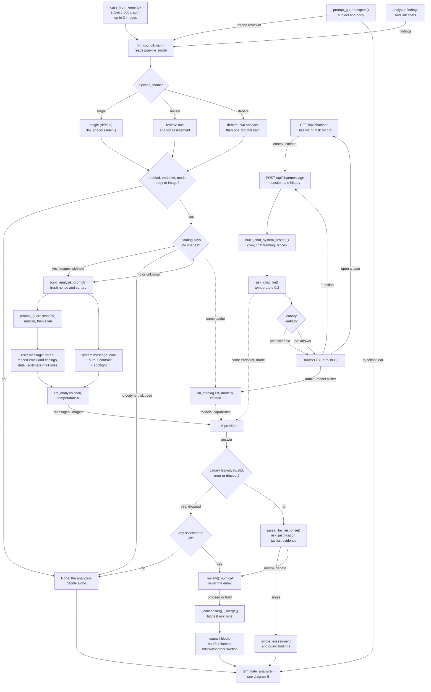

- **Read the analysis from llm_council.main() down to terminate_analysis().** Solid arrows are the analysis; the case chat (GET /api/chat/load onwards) is a separate path. Dotted arrows reach the same LLM provider or catalog, but they are not steps of the analysis. The mode is chosen before anything else: single never enters council code and has its own 240 s budget per request. Review and debate share one 420 s budget for the whole council, and have no budget per call. The steps from the image check to parse_llm_response() are one assessment call (query_llm(), or _rebuttal() in a debate round); it runs once in single and review. In debate it runs four times: analyst_a and analyst_b in parallel, then one rebuttal each. A rebuttal is _rebuttal(): it builds the same prompt, appends the other agent's answer sanitized and fenced as UNTRUSTED-PEER-ASSESSMENT, and calls chat() directly; _clamp_revision() lets a revision raise only. The precondition (enabled, endpoint and model set, a body or a readable image present) is checked in llm_analysis.main() or llm_council.main().
- **What the model sees.** The system message is llm_analysis.system_prompt (or DEFAULT_SYSTEM_PROMPT), then ANALYSIS_OUTPUT_CONTRACT, then spotlight_instruction(). The user message carries the guard notes, the sender authentication (safe_token), the brand consistency check, today's date and the legitimate-mail rules, the fenced findings and link hosts, a fenced gateway banner, the fenced email and an image note. In detail, the model sees:
  - the sanitized subject, and the body cut to 6000 chars;
  - the analyzer summary with the link hosts (summarize_analyzer_findings() and summarize_link_destinations()), fenced because every host in it was chosen by the attacker;
  - the SPF/DKIM/DMARC results and the From domain, each reduced to a safe_token;
  - a fixed trusted block with the brand consistency check, a fixed trusted block with the brand consistency check, today's UTC date (YYYY-MM-DD) plus the instruction to read dates in the email as DD/MM/YYYY, and the rules for legitimate mail (commercial persuasion alone is not social engineering);, and the rules for legitimate mail (commercial persuasion alone is not social engineering);
  - up to three attached or inline images ([§8.3](BLUEPHISH_ARCHITECTURE.md#83-prompt-injection-defences-prompt_guardpy)).

  The guard notes go first, outside every fence, so the evidence the sanitizer removed still reaches the model. A recipient gateway banner is fenced separately, never removed. Each request gets a fresh nonce and canary.
- **Two separate injection signals.** run_analysis.main() scans the email itself, apart from the model. That finding raises Safe to Suspicious in [diagram 9](#9-verdict-decision-chain) even when the LLM is off, and it is also handed to the reviewer. scan_output() inside each call is the other signal: a leaked canary means the injection worked. An echoed fence or a markdown image is kept, with a warning in single mode. In single mode a leak or an invalid answer gives None (single parses first, the council scans first). In council modes only that call is lost. A first-round agent loses its assessment, and a rebuttal loses only its revision, so the original stands. The council returns None only when no assessment is left, or when the 420 s budget runs out first.
- **What an answer holds.** parse_llm_response() reads risk_level (Low to Critical), a justification of up to 500 characters, a closed list of tactics and the evidence. llm_analysis.chat() runs at temperature 0, against Ollama /api/chat with format json or an OpenAI-compatible endpoint with a bearer API key. In single mode the result is the assessment plus the guard findings (sanitized, injection, output).
- **Council modes ([§8.5](BLUEPHISH_ARCHITECTURE.md#85-multi-agent-pipelines--llm_councilpy)).** The reviewer makes its own model call and reads the verdicts, the injection findings, the analyzer summary and the fenced justifications, never the email. The analyzer summary goes in unfenced, under a 'trustworthy' label, although it names attacker-chosen hosts — a known gap to fix in code ([§8.5](BLUEPHISH_ARCHITECTURE.md#85-multi-agent-pipelines--llm_councilpy)). proceed changes nothing. What has an effect is hold_for_human, disagreeing agents, or a debate with only one surviving agent. hold_for_human is also what a reviewer that failed, timed out or leaked its canary leaves behind (reported as unavailable). _merge() keeps the highest risk and unions the tactics and evidence; _consensus() decides whether the agents agree. Any of those holds sets holdForHuman, and [diagram 9](#9-verdict-decision-chain) raises Safe to Suspicious. trustAutonomousAction needs a reviewer that answered proceed, plus consensus. In single mode there is no council block, and terminate_analysis() treats the gate as open.
- **Vision needs the catalog.** Images (up to 3 attached or inline, at least 8 KB each, 4 MB in total, whitelisted hashes skipped) are withheld only when llm_catalog.accepts_image(model) reports an explicit False. When the capability is unknown (None), the images are still sent. OpenRouter rejects the whole request when a text-only model gets an image, and the fail-open path would then drop the assessment without saying why. An email with only images, sent to a text-only model, is skipped in every mode. The analysis calls llm_catalog.list_models() in process, not the admin route (POST /llm-models, requires_admin, the Settings IA tab). It shares that model picker's cache, which is keyed by endpoint and API key, so the provider's catalog (OpenRouter's public /api/v1/models, Ollama /api/tags and /api/show, others /models and /model/info) is fetched at most once per cache period (300 s, or 60 s after an error) instead of once per email.
- **The chat is a second surface with the same guard.** GET /api/chat/load/:case_ref and POST /api/chat/message both require requires_analyst. build_chat_context() reads the case back from TheHive or the Disk archive, and the chat routes keep it in chat_contexts; a Jira reference is refused. The question is up to 2000 characters, with the last 12 history turns sanitized. build_chat_system_prompt() uses the same core prompt plus the chat framing and spotlight, and runs inspect() on the subject, body and observables, and sanitizes and fences them together with the recorded assessment. ask_chat_llm() answers in free prose at temperature 0.2, so a leaked canary withholds the answer outright; otherwise the answer comes back with injectionDetected. The analyst's own question is not scanned ([§8.4](BLUEPHISH_ARCHITECTURE.md#84-chat-context-prompt)). The chat does not check llm_analysis.enabled: an endpoint and a model are enough. The audit assistant ([diagram 16](#16-audit-trail)) shares ask_chat_llm() and the same guard layers.

Drawn from: `app/run_analysis.py` · `app/case_from_email.py` · `app/llm_council.py` · `app/llm_analysis.py` · `app/llm_catalog.py` · `app/prompt_guard.py` · `app/thephish_app.py` · `app/auth.py` · `app/templates/index.html` · `docker/docker-compose.yml`

---

<!-- Records and follow-up -->

## 11. Recording destinations and history

The history screens have no table of their own behind them. The recording destinations are the system of record for what was analyzed ([§4.8](BLUEPHISH_ARCHITECTURE.md#48-case-history-and-insights)). The small tables this app does keep (analysis_history for whitelist simulation, fingerprints, reclassifications) are never listed as history. Once the verdict exists, run_analysis.py turns the result into a plain-data report (tickets.build_report()) and hands it to every enabled recording destination. TheHive, Jira and the Disk archive go through tickets.dispatch(), then the Generic connectors go through connectors.dispatch(). The top half of the diagram is that write path. The bottom half is the read path behind /api/cases, /api/insights and /api/insights/windows.

Both halves follow one contract. Every destination filters by verdict with the same accepts_verdict() rule. No failure may undo a finished analysis, so create() and deliver() never raise. On the read side, no source can become the only one. select_cases() reads every enabled destination and names the ones it could not read in `notice` and `partial`, so a short list is never shown as the whole history. A source that cannot answer for something (Jira observables) answers None, never zero ([§4.8](BLUEPHISH_ARCHITECTURE.md#48-case-history-and-insights)). Generic connectors are write-only: nothing reads them back.

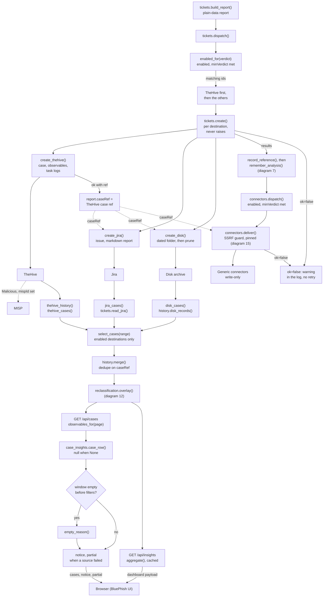

- **What each step does.** build_report() flattens verdict, observables, findings, llm, verdictTrail and body into plain data; run_analysis.main() then adds the score, the bulk signals and the notifications sent. create() turns a TicketError, a timeout or a connection error into ok=false. create_thehive() uses the ThePhish template, tags the case with the card's tags plus analysis_tags(), adds the observables including files, puts the report in the analysis task log and the notifications in the notification task, resolves Malicious and Safe and leaves Suspicious open. create_jira() opens an issue titled '[verdict] subject' with the report as markdown and attaches the .eml when attachEml is 'sim'. create_disk() writes a timestamp-subject folder with report.json, report.md, email.eml (writeEml) and body.txt (writeBody), then runs prune_old_analyses(retentionDays). connectors.deliver() renders the placeholders, calls validate_destination() at fire time, caps the body at 512 KB and connects through pinned_http with no redirects. A failure logs 'did not record the analysis'.
- **The order in dispatch is about references, not precedence.** tickets.dispatch() sorts TheHive first because it is the destination that returns a case number. It writes that number into `report.caseRef` in place, so the Jira description, the disk `report.json` and any connector that uses the caseRef placeholder all carry it. The disk copy of `caseRef` is what lets history.dedupe() show one row for an email that TheHive and disk both recorded.
- **Filtering happens twice, on purpose.** enabled_for() picks the destinations, and create() checks `enabled` and `minVerdict` again, so a direct call cannot bypass them. Connectors use the same tickets.accepts_verdict() rule. The defaults differ: TheHive is `all` and the only destination enabled out of the box, Jira is `Suspicious`, disk is `all`. MISP is reached only through TheHive: on a Malicious verdict with `mispId` set, create_thehive() asks TheHive to export the case, and the app itself never calls MISP.
- **A failure produces a log line and nothing else.** Each failed destination or connector becomes a `log.warning` plus a `wsl.emit_warning` to the live log, and the verdict does not change. There is no retry, no outbox and no delivery table. connectors.classify() marks 429 and 5xx as `retryable`, and deliver() marks timeouts and connection errors the same way, but nothing reads that flag. build_report, tickets.dispatch and connectors.dispatch also share one outer try/except that only logs. An exception before the connector loop therefore skips every connector for that analysis.
- **A reanalysis records again.** run_analysis.main() with notify=False runs the same hand-off, so every enabled destination and connector gets a new record. Only case_scope, through `report_of`, ties it back to the report it re-examines ([diagram 12](#12-after-the-verdict)).
- **Only enabled destinations are read, and each only for what it holds.** Every history route requires_analyst. thehive_cases() uses query fallbacks and filter_cases() keeps the cases with the tag markers. history.disk_records() windows by folder name and runs read_report() per report.json, returning full reports with observables. tickets.read_jira() searches by JQL project and labels and reads the verdict from the summary; Jira returns verdict, title, date and labels, with observables set to None, which case_row() renders as `observableCount: null` and `iocCount: null`. select_cases() reads only the enabled destinations and names a reader that raises in its failures. history.merge() keeps the TheHive row on a caseRef match, windows, sorts newest first and sets truncated when the limit cuts. TheHive observables are fetched only for the page on screen or for threat cases (observables_for()), and None is kept. Two gaps: when one TheHive case's observable fetch fails, thehive_observables_for() still returns `[]`, so that row shows zero. And jira_cases() sets `caseRef` to an empty string, so with both TheHive and Jira enabled the same analysis is listed twice.
- **Write tags and read tags come from different settings.** create_thehive() tags the case with the TheHive card's `tags`, which is seeded from configuration.json `case.tags` but overridden by the value saved on the card. The reader filters by the last `case.tags` entry or a former product marker (CASE_TAG_ALIASES). If one changes without the other, new cases drop out of the history with no error.
- **`notice` and `partial` are the honesty layer.** An empty window (checked before the filters) asks cases_empty_notice() and case_insights.empty_reason() why. A destination that raised, or reclassifications that could not be loaded ('reclassificações manuais'), are named in the notice ('Parte do histórico não pôde ser lida') and `partial` is set. GET /api/insights and /api/insights/windows (case_insights.aggregate() / count_windows()) return `partial` and `unread` instead, cached 120 s. `recording` in cases_empty_notice() means 'some enabled destination accepts Suspicious', not 'some destination is enabled'.
- **Neighbours:** [diagram 15](#15-ssrf-guard-chain) covers the SSRF guard inside connectors.deliver() and tickets._jira_call(). [diagram 12](#12-after-the-verdict) covers reclassification. [diagram 7](#7-running-the-analysis-and-closing-it) covers remember_analysis(). The volume-alert webhooks reuse connectors.deliver() with their own context builder, outside this flow.

Drawn from: `app/tickets.py` · `app/run_analysis.py` · `app/connectors.py` · `app/thephish_app.py` · `app/case_insights.py` · `app/history.py`

## 12. After the verdict

This diagram covers what happens after the pipeline has decided. An analyst opens a case from the work desk (Filas de Trabalho) or the archive and can decide its verdict. The server checks the decision against the verdict it reads back from the destination, stores it as an append-only row, then writes it to TheHive, Jira or the Disk archive. A corrected false positive then has side effects: the errata to the reporter, and the verdict memory that changes later analyses. Separately, an admin can push chosen indicators to the Blocking destinations (EOP / firewalls). Nothing in this diagram runs on its own. Every path starts with a person clicking.

The order matters. The decision is committed to the local database first. Every later step (destination write, SMTP, memory) can only add an outcome row that the screen shows, and none of them can undo the decision ([§4.8.1](BLUEPHISH_ARCHITECTURE.md#481-why-a-verdict--and-an-analyst-disagreeing-with-it)). The case scope count and the fingerprint keys that the errata and the memory depend on come from analysis_fingerprint. run_analysis.remember_analysis() writes one row per destination record at the end of each recorded analysis ([diagram 7](#7-running-the-analysis-and-closing-it)). A record analyzed before that table existed answers None, never zero.

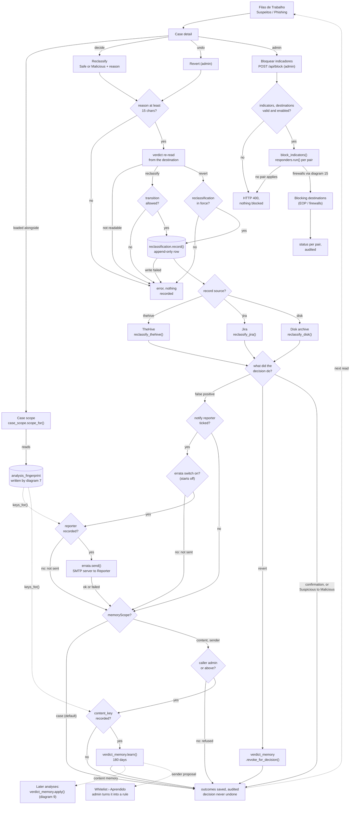

- **A solid arrow is part of one request. A dotted arrow is data that a later request reads.** The diagram runs from the work desk and case detail ([§7.16](BLUEPHISH_ARCHITECTURE.md#716-the-work-desk-queues-scope-and-the-errata)) through the reclassification ([§4.8.1](BLUEPHISH_ARCHITECTURE.md#481-why-a-verdict--and-an-analyst-disagreeing-with-it)) and the destination holding the record ([diagram 11](#11-recording-destinations-and-history)) to the false-positive follow-up; blocking ([§4.5.2](BLUEPHISH_ARCHITECTURE.md#452-blocking-destinations-responderspy)) is the separate branch at the side. The desk queues change only on the next GET /api/cases. select_cases() then lays the decisions over the records (reclassification.overlay() through case_insights.apply_decision()), and the pending=1 filter in api_cases drops every row that carries a reclassification. A revert sets reclassification back to None, so the case returns to its queue with the old verdict.
- **Routes, fields and rules.** The queues are GET /api/cases?pending=1 and the case detail is GET /api/cases/<case_ref>, both requires_analyst; the detail carries decisionTargets, errataEnabled, reporterKnown and canTeach. The scope is GET /api/cases/<case_ref>/scope (requires_analyst): case_scope.scope_for() counts distinct reporters with first and last seen. analysis_fingerprint holds content_key, body_key, sender_key and reporter, written by run_analysis.remember_analysis() ([diagram 7](#7-running-the-analysis-and-closing-it)). Deciding is POST /api/cases/<case_ref>/reclassify (requires_analyst) with target Safe or Malicious and a reason ('Marcar como legítimo' / 'Confirmar malicioso'); undoing is POST /api/cases/<case_ref>/reclassify/revert (requires_admin), back to previousVerdict. reclassification_target() and current_decision() re-read the verdict from the destination, never from the browser; a record not found, Jira off or decisions that cannot be read refuse the request. The row goes to case_reclassification. TheHive is set to Resolved FalsePositive or TruePositive, or reopened when Suspicious, with the reason in the task log; Jira gets the verdict prefix in the title plus a comment; the Disk archive replaces report.json atomically and adds a note to report.md. At the end, save_outcomes() and insights_cache.clear() run and auth.audit records case_reclassify or case_reclassify_revert.
- **Every role check happens on the server.** Deciding is requires_analyst. Undo and blocking are requires_admin on the route. Teaching the memory (content or sender scope) is checked inside false_positive_follow_up() with has_role_at_least(admin), whatever the browser showed. canTeach only hides the control. When the lesson is refused, the refusal is audited and the analyst's decision still stands.
- **The two decisions are asymmetric** (reclassification.TRANSITIONS, re-checked on the server against the verdict read from the destination). Safe can come from Malicious or Suspicious, Malicious from Suspicious or Malicious. A Safe email is never condemned from here. Malicious over Malicious is a *confirmation*: the verdict does not change, and the case leaves the queue because it now carries a decision; Suspicious raised to Malicious also goes straight to the close. Only a false positive (is_false_positive(): Malicious or Suspicious to Safe) starts the follow-up, false_positive_follow_up(). That follow-up handles the errata first and then the memory scope, one after the other, in the same request.
- **The errata has three locks:** the per-decision tick (notifyReporter=1), the errataEnabled switch (Configurações › Notificações) and a reporter recorded in analysis_fingerprint. The switch does not inherit the old enabled flag (mailer.EVENTS_WITHOUT_LEGACY), so it starts off. errata.send() goes through mailer.send(). If the switch or the reporter lock blocks the errata, it adds an outcome row saying why ('não enviada: ...') and never a fake 'sent'. An unticked box is the analyst's own choice and records nothing.
- **The sender scope never lowers anything by itself.** verdict_memory.learn() writes a memory that expires in 180 days. The content scope lowers the identical message. The sender scope saves the identical-message memory plus a *proposal*, and only when the sender address was read. The proposal takes effect only after an admin turns it into a sender rule under Whitelist › Aprendido (POST /api/whitelist/rule with memoryProposalId), with domain authentication and a dry run ([§7.17](BLUEPHISH_ARCHITECTURE.md#717-verdict-memory--what-a-correction-teaches-verdict_memorypy)). [diagram 9](#9-verdict-decision-chain) covers what happens next: how verdict_memory.apply() lowers a verdict inside run_analysis.terminate_analysis(), fails closed and counts as rule `vm_<id>` in the suspension loop.
- **Blocking is never automatic and is separate from reclassification.** No pipeline code calls responders.py. 'Bloquear indicadores' is offered on the case detail and on a recurring IOC. POST /api/block takes 1 to 50 indicators and at least one destination, and every chosen destination must be enabled. block_indicators() loops over indicator x destination, skips types outside responders.available_targets() and calls responders.run() once per pair: EOP blocks mail, domain, url and hash; PAN-OS, FortiGate and Check Point block ip, domain and url. It returns one result per pair (blocked, already, pending or error), audited as indicator_block, so one unreachable firewall does not hide the EOP result. An empty result is an HTTP 400. 'pending' means written but waiting on a commit or policy install, not blocked. Firewall management addresses go through validate_destination() and pinned_http with allow_internal ([diagram 15](#15-ssrf-guard-chain)). EOP calls fixed Microsoft endpoints.
- **Case scope is read-only here.** The desk asks for it on its own route, so one indexed local query is not held up by a slow TheHive. It counts distinct reporters. It matches by content_key and by body_key and keeps whichever finds more, which covers a subject rewritten on forwarding. It answers None, never zero, when there is no fingerprint or no reporter was recorded.

Drawn from: `app/static/assets/js/bluephish.js` · `app/templates/index.html` · `app/thephish_app.py` · `app/reclassification.py` · `app/case_insights.py` · `app/case_scope.py` · `app/run_analysis.py` · `app/tickets.py` · `app/errata.py` · `app/mailer.py` · `app/models.py` · `app/verdict_memory.py`

## 13. Data model

The Bluephish app keeps one SQLite file, thephish.db, which holds seven tables. All seven are declared in models.py, and the engine is sqlite:///{DB_PATH} with check_same_thread off. Cases, observables and analyzer reports are not stored here. They live in the enabled recording destinations ([diagram 11](#11-recording-destinations-and-history)). The database holds what those destinations cannot answer: who may sign in (users), what the whitelist and verdict memory did to each verdict (whitelist_rule_state, whitelist_suppression, analysis_history, verdict_memory), what an Analyst decided afterwards (case_reclassification), and how many people reported the same message (analysis_fingerprint).

The schema declares no ForeignKey and no relationship(). Every line in the diagram is a logical link by value: a username copied into created_by, a record_ref string, a rule id such as wl_… or vm_<id>. Two of these are clearly deliberate. A record_ref can point to TheHive, to disk or to Jira, and one rule-state table counts both whitelist rules and verdict memories. Because created_by is a copied username, deleting an account leaves the name on every decision and memory it signed. Dotted lines mean 'matched by value, no constraint', and each line's label names the column that carries the value.

Each table shows its key and its main columns. The reading notes list the other columns and what each column holds.

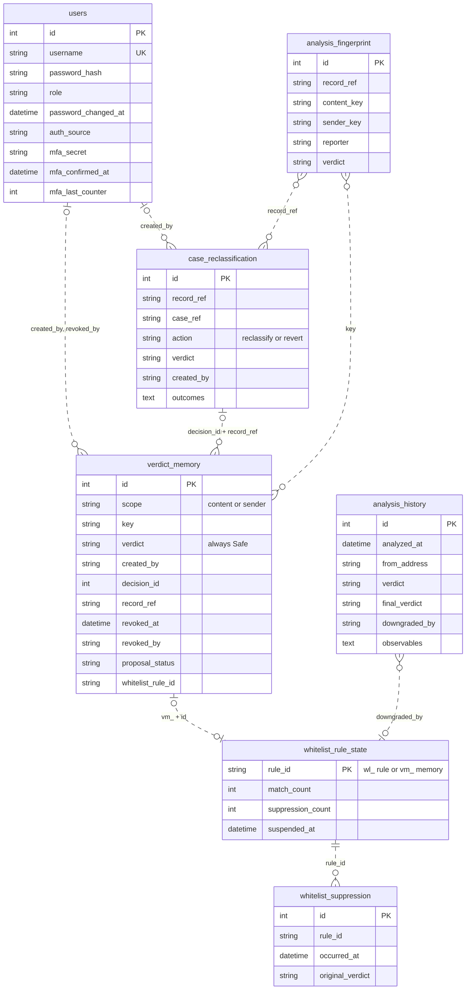

- **No foreign keys.** models.py declares none, and SQLite enforces nothing between these tables. Every link is matched in Python by value, and each line's label names that value. created_by and revoked_by are copied usernames. analysis_fingerprint and case_reclassification share a record_ref. verdict_memory.key is a fingerprint's content_key or sender_key. analysis_history.downgraded_by is a whitelist_rule_state rule_id, and vm_ + id is the rule_id of a verdict memory. Because the usernames are copies, when auth.py deletes a users row, the name stays on every decision and memory that account signed.
- **Decision and memory are matched on two fields.** verdict_memory.revoke_for_decision() filters on decision_id and record_ref together. The id alone is not enough: a decision embedded in a report.json from another installation or a restored backup carries an id that may belong to a different decision here.
- **One rule-state table serves two powers.** whitelist_rule_state.rule_id holds either a whitelist rule id (wl_ + 8 hex characters, created in whitelist.py) or a verdict memory as vm_<id> (verdict_memory.rule_id_of). Both kinds of downgrade go through whitelist_state.register_downgrade(). That puts them in the same whitelist_suppression timeline and the same auto-suspension loop. analysis_history.downgraded_by names whichever one fired ([§7.17](BLUEPHISH_ARCHITECTURE.md#717-verdict-memory--what-a-correction-teaches-verdict_memorypy), [diagram 12](#12-after-the-verdict)).
- **Declaration and runtime live in different places.** The whitelist rules themselves sit in whitelist.json, not in the database. The tables hold only what happens at runtime, because the analysis path writes on every email and rewriting the JSON each time would overwrite an edit just saved in the UI. verdict_memory.whitelist_rule_id points into that JSON file once an admin accepts a sender proposal.
- **Mostly append-only.** case_reclassification never rewrites a decision: an undo is a new row with action revert, and the latest row per record_ref wins. The only update is reclassification.save_outcomes() filling in outcomes after the destinations and follow-ups (errata, verdict memory) have answered. verdict_memory is revoked by filling revoked_at, never deleted. Rows are deleted in three functions. auth.py deletes a users row (never the last global_admin). whitelist_state.prune() removes analysis_history older than 90 days (configurable) and suppressions older than 365 days, at most once an hour. whitelist_state.clear_suspension() wipes one rule's suppressions when an admin resumes a suspended rule.
- **The additive migration.** create_all() creates missing tables but never adds a column to one that already exists. After it runs, init_db() calls _add_missing_columns(), which reads PRAGMA table_info and runs ALTER TABLE … ADD COLUMN for each column listed in NEW_COLUMNS. A table that create_all() has just built is skipped, because it already has every column. Today the list holds only the four users columns added for SSO and MFA: auth_source with a 'local' default, plus the three nullable MFA columns mfa_secret, mfa_confirmed_at and mfa_last_counter. On older databases these four arrive by ALTER. A pre-MFA account therefore comes back as "not enrolled yet", which is exactly the state the login flow intercepts ([diagram 14](#14-authentication-and-session)).
- **What is not in the database.** Several stores sit on disk in the data/ bind mount: the audit trail (data/auth.log, or auth.log in a subfolder of data/ that the global_admin picks, rotated by audit_store.py and optionally copied to Syslog / SIEM, [diagram 16](#16-audit-trail)), the original .eml files (data/originals via case_evidence.py and eml_store.py), rendered layouts (data/rendered via render_store.py), the volume-alert state (data/volume_alerts.json) and the TLS certificate and key (data/thephish-cert.pem, data/thephish-key.pem). Configuration lives in configuration.json, including custom analyzers, generic connectors and the auditLog settings. Disk archive records live under the Disk archive destination's own path as report.json. None of these are tables.
- **Fail-open vs fail-closed reads.** whitelist_state.suspended_ids() fails open: with the database down, no rule is treated as suspended. verdict_memory.match_content() and is_suspended() fail closed: with the database down, nothing is downgraded. [§7.17](BLUEPHISH_ARCHITECTURE.md#717-verdict-memory--what-a-correction-teaches-verdict_memorypy) explains the asymmetry.
- **What the columns hold.** users.username is unique (UK), indexed and at most 64 characters. password_hash is bcrypt, role is analyst, admin or global_admin, password_changed_at is the session revocation marker, auth_source is local or sso, and mfa_secret is TOTP base32. analysis_history.verdict is the verdict before whitelist and memory, and final_verdict the one after. downgraded_by is a nullable rule id, and observables is JSON by type. case_reclassification.case_ref is the TheHive case number, and outcomes is JSON. analysis_fingerprint.content_key and body_key are sha256, and sender_key is the normalized From. verdict_memory.decision_id is nullable, proposal_status is pending, accepted, dismissed or empty, and whitelist_rule_id names a rule in whitelist.json. Indexed columns: users.username; whitelist_suppression.rule_id and occurred_at; analysis_history.analyzed_at; case_reclassification.record_ref, case_ref and created_at; analysis_fingerprint.record_ref, case_ref, content_key, body_key, sender_key and analyzed_at; verdict_memory.scope, key, created_at and decision_id.
- **Columns not drawn.** users: failed_logins, locked_until, last_login. whitelist_rule_state: last_matched_at, suspended_reason. whitelist_suppression: message_from, message_subject, detail. analysis_history: from_domain, reply_to, subject, authenticated (bool). case_reclassification: previous_verdict, reason (text), created_at. analysis_fingerprint: case_ref, body_key, subject, analyzed_at. verdict_memory: reason (text), created_at, expires_at, hits, last_hit_at.

Drawn from: `app/models.py` · `app/auth.py` · `app/whitelist_state.py` · `app/run_analysis.py` · `app/reclassification.py` · `app/thephish_app.py` · `app/case_scope.py` · `app/verdict_memory.py` · `app/whitelist.py` · `app/manage.py` · `docker/docker-compose.yml` · `app/audit_store.py`

---

<!-- Security surfaces -->

## 14. Authentication and session

This diagram shows how a person gets into Bluephish app and what every request has to pass after that. The first factor can be proved two ways. A local password goes through POST /api/auth/login, which checks the account source, then the lockout, then bcrypt. Corporate SSO is OpenID Connect (authorization code + PKCE) against the Identity provider (Entra ID / OIDC), and the group or App Role in the token decides the role. Neither path opens a session. Both end in a TOTP challenge stored in the signed session cookie. flask_login.login_user() runs only after a valid code, in auth._complete_login(), and the requests that follow carry the signed session cookie. Until then current_user is anonymous. Every decorated route and the websocket handshake refuse an anonymous caller. The session policy and the MFA safety net let an anonymous caller through untouched, so the route's decorator is what refuses it, and none of these layers needs to know that MFA exists.

The bottom block is the per-request enforcement described in [§3.2](BLUEPHISH_ARCHITECTURE.md#32-enforcement) and [§4.3](BLUEPHISH_ARCHITECTURE.md#43-session-lifecycle-authenforce_session_policy-runs-before_request): before_request hooks, run in registration order. The sign-in calls pass through it too. CSRF runs first, then the session policy (absolute and idle timeouts, revocation on password change, tab liveness), then the MFA safety net. After those, the route's own requires_role decorator decides on the server. Hiding a button in the UI is never the control.

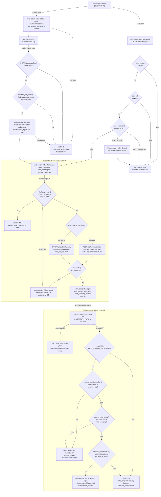

- **A correct password is only half a login.** api_login deliberately does not reset failed_logins, so the 'yes' edge out of the password check leaves the counter as it is. Wrong TOTP codes (activate and verify) and a wrong current password on POST /api/users/change_password all call the same User.register_failed_login(). Five mistakes spread across both factors therefore still lock the account for 15 minutes, with locked_until = now + 15 min ([§4.1](BLUEPHISH_ARCHITECTURE.md#41-password-and-lockout-policy-modelspy), [§3.3](BLUEPHISH_ARCHITECTURE.md#33-password-change-rules)). When the threshold is reached, the lock is set and the count starts again from zero. On the password path the counter is cleared only in _complete_login, after both factors, or by a global_admin unlock. The SSO path is the exception: models.sso_sign_in() calls register_successful_login() while it provisions the account, before the second factor, and sso_callback never checks is_locked(). A locked account that comes back through the identity provider gets a fresh challenge, and the TOTP is still required.
- **Every refusal gives the same message.** POST /api/auth/login is rate limited to 5 per minute per IP. It checks auth_source first, then the lock (locked_until in the future), then that the user exists and bcrypt check_password accepts the password. It refuses an SSO-only account, a locked account, an unknown user and a wrong password with the same GENERIC_LOGIN_ERROR ('Invalid username or password') and a 401. Nobody can use it to enumerate users or to find out which accounts they locked. SSO refusals travel as a code from the closed SSO_ERRORS list, and the login page picks the sentence, so text from the provider or from the URL never lands on a page that asks for a password.
- **The SSO return must pass the callback checks, then needs a mapped role.** sso.begin() keeps the flow, with state and code_verifier, in the session. GET /auth/sso/start is refused (not configured, or begin() failed) before the browser is sent to the provider. The checks at GET /auth/sso/callback are: the flow is in the session, sso.complete() is valid, a username is present, and there is no group overage. In sso.role_for_claims() the highest mapped role wins. models.sso_sign_in() never demotes the last global_admin, and a ValueError from it is a provisioning failure. On success the callback calls _start_mfa_challenge(user, 'sso') and then redirects to /login.
- **Every code attempt goes back through the challenge check.** The login page (after an SSO return) or login.js (after the password) opens the enroll or verify step, chosen by User.mfa_is_enrolled(). auth._challenge_user() accepts the challenge only while it is under 10 minutes old and the account is not locked. Otherwise the answer is 401 with restart, and login.js returns to the password form. An activate or verify call that does not match the enrolment state answers 409 with restart, which has the same effect. A setup call on an account that is already enrolled answers 409 without restart, and the error is shown in place. mfa.verify() takes 6 digits on a 30 s step and accepts a match within 1 step either side.
- **Enrolment proves the phone before it grants anything.** /mfa/setup stores the secret as a proposal (mfa_confirmed_at is null). Only a correct first code in /mfa/activate confirms it and opens the session. /mfa/verify rejects any step at or before mfa_last_counter, so a code that was already used cannot be replayed inside its 90-second window. A lost phone is cleared by a global_admin (POST /api/users/<id>/mfa/reset) or by an operator on the host (manage.py reset-mfa). There is no e-mail or SMS path.
- **auth.enforce_mfa_policy() is a safety net, not the gate.** The gate is that login_user never runs before the code. The before_request net drops any authenticated session that lacks the mfa_ok stamp, for example a session that predates MFA, or a future login path that forgets the second factor. socket_guard.admit() applies the same session controls plus the stamp to the Socket.IO handshake ([§4.3](BLUEPHISH_ARCHITECTURE.md#43-session-lifecycle-authenforce_session_policy-runs-before_request)), because before_request does not run there.
- **The session policy is the whole rule in one function.** auth.enforce_session_policy() lets an anonymous caller through. For a signed-in one, 'session valid' means auth._session_violation() finds nothing. It checks, in order: absolute 12 h (started_at), idle 30 min (last_seen), revocation on password change (pwd_marker compared with password_changed_at), and tab liveness (sid in the in-memory _live_sessions, with a grace of BLUEPHISH_TAB_GRACE_SECONDS, default 300, minimum 60). start_session(), called from _complete_login, writes started_at, last_seen, pwd_marker, sid and the tab token. HTTP and the websocket share the rule. A passing request refreshes last_seen and the live registry, which is what makes the idle timeout sliding. POST /api/auth/heartbeat also revokes the session at once when the X-Session-Tab token is missing or differs from tab_token. Changing a password bumps password_changed_at, and that user's other sessions die on their next request.
- **Flask-Login runs one more check, and it is silent.** login_manager.session_protection is 'strong', and the session is never marked permanent. A request whose IP or User-Agent hash differs from the one recorded at login_user loses its user keys and arrives anonymous, then gets the 401 from requires_role. Unlike the refusals from enforce_session_policy, it writes no audit record and does not forget the sid.
- **RBAC is an ordered list, not a set of permissions.** ROLES = analyst, admin, global_admin. The route decorator requires_role(minimum) compares list indexes, so each role includes the ones below it. Every @app.route in thephish_app.py carries one of the three decorators. The only undecorated routes are the auth ones listed in PRE_SESSION_ENDPOINTS, plus /api/auth/me and /api/auth/heartbeat, which check current_user themselves. The 'yes' edge of the PRE_SESSION_ENDPOINTS check covers login, logout, SSO, MFA and static, which skip the session and MFA policy. [diagram 15](#15-ssrf-guard-chain) covers the SSRF chain behind the admin-only integration settings, and [diagram 16](#16-audit-trail) covers the audit trail these refusals write to.
- **CSRF covers the login too.** CSRFProtect's before_request is registered before the session policy and has no exemptions, so POST /api/auth/login and the MFA posts need the token as well. The token comes from the readable csrf_token cookie, which after_request refreshes on every response. Over HTTPS, Flask-WTF also checks the Referer header, and that is why Referrer-Policy stays same-origin ([§4.4](BLUEPHISH_ARCHITECTURE.md#44-csrf)). With no-referrer, every POST would fail with a 400, the login included.

Drawn from: `app/auth.py` · `app/thephish_app.py` · `app/models.py` · `app/static/assets/js/login.js` · `app/mfa.py` · `app/sso.py` · `app/socket_guard.py` · `app/manage.py`

## 15. SSRF guard chain

Seven modules pass an address that is not in the source code through the SSRF guard before the Bluephish app dials it. Five of those addresses were typed by an admin, and two were written by whoever sent the phishing. Every one of them goes through custom_analyzers.validate_destination(). The guard checks the scheme, resolves the name, and refuses the address if any resolved IP is forbidden. The HTTP consumers, all except TheHive, then connect through pinned_http.py. It resolves the name once more inside the connection, judges every address with the same rule, and opens the socket on that exact IP. A hostile DNS server therefore cannot give the guard one answer and the connection another (DNS rebinding, [§4.5.1](BLUEPHISH_ARCHITECTURE.md#451-analyzers-the-analyst-defines) point 7).

Consumers are grouped by how they set allow_internal, because that argument is where they differ. unshorten.py and email_render.py never pass it. custom_analyzers.py and connectors.py read it from the saved definition. tickets.py, responders.py and audit_store.py pass True by construction (allow_internal = True). What each consumer does before and after the guard is covered in the neighbouring diagrams: [diagram 8](#8-choosing-and-running-analyzers) (unshorten, custom analyzers), [diagram 11](#11-recording-destinations-and-history) (tickets, connectors), [diagram 12](#12-after-the-verdict) (responders) and [diagram 16](#16-audit-trail) (audit_store syslog).

```mermaid
flowchart TD
  subgraph CONS["Consumers, by allow_internal"]
    direction LR
    subgraph NEVER["Internal network: never"]
      direction LR
      UN["unshorten.resolve()<br/>first URL and every redirect hop"]
      ER["email_render.py<br/>RemoteImageFetcher._fetch_once()<br/>reported email's remote images"]
    end
    subgraph SAVED["Internal: only with saved allowInternal"]
      direction TB
      CA["custom_analyzers.query()<br/>analyst-defined analyzer URL"]
      VA["volume_alerts.deliver()<br/>volume-alert webhooks"]
      CO["connectors.deliver()<br/>Generic connectors"]
      VA --> CO
    end
    subgraph OPEN["Internal: allowed by construction"]
      direction LR
      TJ["tickets._jira_call()<br/>Jira URL"]
      TH["tickets.validate_entry()<br/>TheHive URL, on save only"]
      RS["responders._guard()<br/>PAN-OS, FortiGate, Check Point<br/>management URL"]
      AUD["audit_store.resolve_syslog()<br/>Syslog / SIEM host and port<br/>when the setting is applied"]
    end
  end
  CONS --> V
  V["custom_analyzers.py<br/>validate_destination()<br/>on save and before each call"]
  V --> SH{"scheme accepted<br/>and URL<br/>has a host?"}
  SH -->|"yes"| LD["IP literal: no DNS lookup<br/>name: socket.getaddrinfo(host)"]
  LD -->|"every address"| JU{"any address<br/>forbidden?<br/>_is_forbidden_address()"}
  JU -->|"no"| QH{"consumer is<br/>TheHive?"}
  QH -->|"no"| QS{"consumer is<br/>audit_store.py?"}
  QS -->|"no, HTTP"| PIN["pinned_http.py<br/>request / get / post / session<br/>same allow_internal as the guard"]
  PIN --> NC["pinned connection _new_conn()<br/>asks DNS once, judges every<br/>address: _is_forbidden_address()"]
  NC -->|"all allowed"| SOCK["socket opened on the judged IP<br/>Host header, SNI, certificate<br/>keep the name"]
  SOCK --> RD{"301/302/303/307/308?<br/>allow_redirects<br/>= False"}
  RD -->|"yes"| QU{"consumer is<br/>unshorten.py?"}
  SH -->|"no"| RF["refused: (False, reason)<br/>save forms show the reason<br/>calls: 'Destino recusado: reason'"]
  LD -->|"does not resolve"| RF
  JU -->|"yes"| RF
  QH -->|"yes, later"| THC["thehive4py and thehive_query()<br/>call requests: not pinned, not<br/>revalidated, redirects followed"]
  QS -->|"yes, syslog"| SYS["second getaddrinfo, first address<br/>AuditSyslogHandler gets an IP,<br/>never the name"]
  NC -->|"any forbidden"| DR["DestinationRefused<br/>before any packet,<br/>TLS handshake included"]
  RD -->|"no"| RESP["response returned<br/>to the consumer"]
  QU -->|"no"| NF["redirect never followed<br/>custom_analyzers, connectors,<br/>email_render: named as failure"]
  QU -->|"yes"| HOP["Location becomes the next hop<br/>back through the guard<br/>at most 10 hops"]
  HOP --> V
  TST["test_ssrf_rebinding.py<br/>DNS that changes its answer<br/>after first query, six consumers"] -.->|"guards"| NC
```

- **Two checks, and they protect different things.** validate_destination(url, allow_internal, require_https) checks the scheme first. It accepts https:// only, unless allow_internal is passed or require_https = False, in which case http:// is accepted too. A URL with no host is refused. An IP literal skips the DNS lookup but is still judged. The scheme check protects what goes out in the request: credentials and the observable. The address check protects where the request goes, and it is never waived. That is why unshorten.py and email_render.py can pass require_https = False, since they send nothing secret, and still never pass allow_internal. The TheHive check in tickets.validate_entry() and audit_store.resolve_syslog() also pass require_https = False. Passing allow_internal also accepts http://, because internal services rarely have TLS ([§4.5.1](BLUEPHISH_ARCHITECTURE.md#451-analyzers-the-analyst-defines) point 3). So for tickets.py, responders.py and audit_store.py the scheme rule is effectively http or https.
- **The rule in _is_forbidden_address().** It always refuses unparsable addresses and the cloud metadata addresses 169.254.169.254, fd00:ec2::254 and 100.100.100.200, which are matched in canonical form. With allow_internal it also refuses multicast and unspecified addresses. Without allow_internal it refuses any address that is not is_global, plus multicast and IPv6 site-local. IPv4 carried inside IPv6 is judged as that IPv4. The unspecified rule is what lets test_ssrf_rebinding.py cover tickets.py and responders.py, which open the internal network by construction: the second DNS answer in those tests is 0.0.0.0.
- **Validating only on save is not enough, and validating before the call is not enough either.** Save time gives the admin a clear error message. Call time catches a name that has moved since it was saved. The pinned connection closes the last gap, because requests used to resolve the name a second time on its own. Any consumer that goes back to calling requests directly reopens DNS rebinding, and no unit test fails. Only test_ssrf_rebinding.py catches it, and only for the six consumers it exercises: unshorten, email_render, custom analyzer, connector, Jira and one firewall (FortiGate). The email_render case runs only inside the image, since it needs libmagic. audit_store.py, TheHive, PAN-OS and Check Point are not in the test.
- **TheHive is the one consumer whose HTTP is not pinned.** thehive4py writes cases, and thephish_app.py thehive_query() and chat_extract_email_body() read history, insights and case chat. All of them call requests directly, with no call-time revalidation, and redirects are followed by the library default. The TheHive URL is judged only when an admin saves the destination, with allow_internal = True and require_https = False (the compose service name).
- **audit_store.py does not use pinned_http.** It speaks raw syslog, not HTTP. It validates the syslog host, with allow_internal = True and require_https = False, when the setting is saved and each time audit_store.apply() runs, which is at startup and on every config POST. It then does a second lookup and gives AuditSyslogHandler the first address. That address is not judged again, so the rule that the handler gets the validated IP ([§4.6.2](BLUEPHISH_ARCHITECTURE.md#462-where-the-trail-lives-and-how-long-it-stays-audit_storepy)) is not met today. This is a known gap, to be fixed in code. The audit_store.py docstrings still state the rule as if it held.
- **Redirects.** Every pinned consumer passes allow_redirects = False, but TheHive's clients do not. unshorten.py is the only consumer that uses the Location header, and it sends each hop back through the guard (MAX_HOPS = 10). Jira and the firewall responders do not follow a 3xx either. They have no dedicated message for it, so the response falls through to their generic status handling.
- **Not part of the chain.** Several other destinations are dialled with no guard at all: llm_catalog.py, llm_analysis.py and thephish_app.ask_chat_llm() (LLM provider, including the case chat and the audit assistant), the built-in analyzers in analyzers.py (Analyzer vendors), graph_mail.py and graph_directory.py (Microsoft Graph) and the EOP responder all call requests directly. EOP talks only to the fixed Microsoft hosts login.microsoftonline.com and outlook.office365.com. socket_guard.py is unrelated: it admits Socket.IO sessions and does no outbound networking.
- **Proxy.** A request that the environment routes through HTTP_PROXY/HTTPS_PROXY is not pinned, because the proxy resolves the destination and its egress policy is the control there. The guard still runs before it.

Drawn from: `app/custom_analyzers.py` · `app/pinned_http.py` · `app/connectors.py` · `app/volume_alerts.py` · `app/tickets.py` · `app/thephish_app.py` · `app/responders.py` · `app/unshorten.py` · `app/email_render.py` · `app/audit_store.py` · `app/auth.py` · `app/llm_catalog.py`

## 16. Audit trail

The audit trail has three parts and each has one owner. auth.audit() writes the record. audit_store.py decides where it goes: a file in the data volume and, optionally, a copy to a Syslog / SIEM. audit_trail.py reads it back for the Auditoria screen and its assistant. The diagram follows one record through those three parts. It also shows the two role gates: admin can read the trail, and only global_admin can change where it lives, how long it stays and where it is copied.

The split matters because the two ways of erasing your own tracks, shortening retention and redirecting the syslog copy, sit behind the higher role. Both are checked on the server, not just in the UI. The reading side treats every line as hostile data. The username of a failed login, a blocked indicator and a whitelisted sender were all typed by people who are not operators. The assistant uses the same LLM transport as the case chat ([diagram 10](#10-llm-analysis)), with its own fixed prompt.

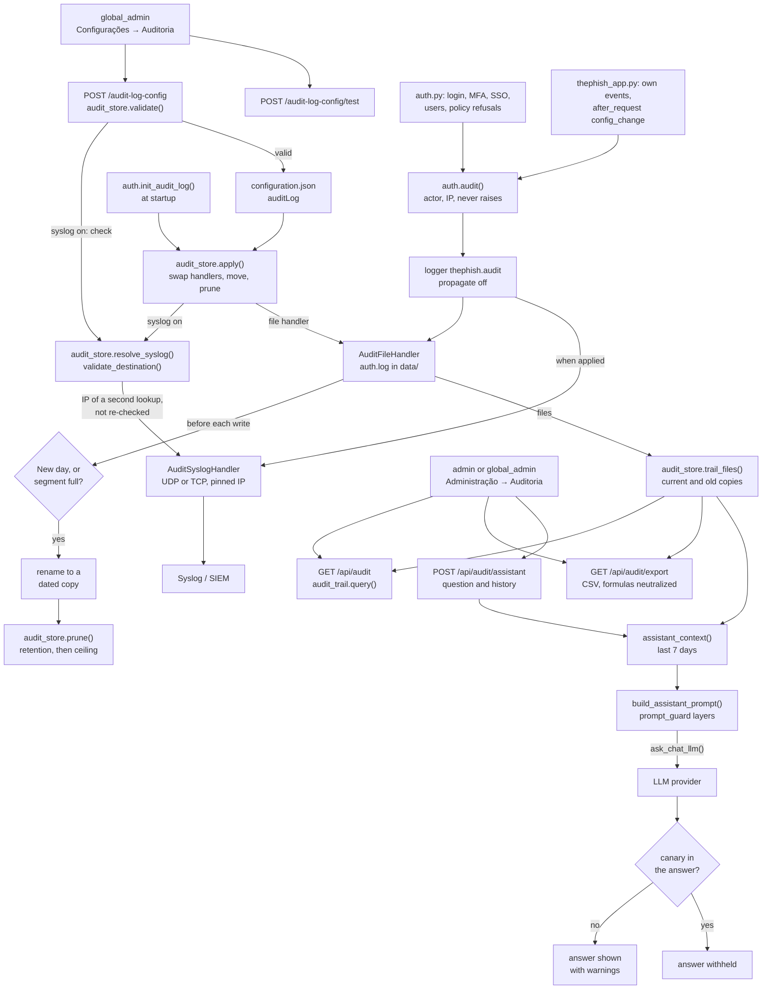

- **Arrows show where a record or a setting flows.** The configuration steps belong to global_admin, the reading steps to admin and above; the writers are web requests. **The trail also records actions on itself**, which the diagram leaves out to stay readable: changing its configuration (audit_log_config_update with before and after, refused, or warning when the ceiling cut or the syslog failed), the syslog test (audit_syslog_test), a CSV export and a withheld assistant answer (audit_assistant refused). Every POST to the assistant also passes the after_request hook, so each question leaves a config_change line with the form field names (history, question) and never their values.
- **Who writes.** auth.py writes login, logout, MFA, SSO, user and password events, and auth.requires_role() plus the session and MFA policy write authorization_denied, session_expired, session_revoked and mfa_gate. thephish_app.py routes write their own events (whitelist, connectors, responders, indicator_block, reclassification, verdict memory, settings), and its after_request hook _security_headers() writes config_change for every POST, PUT, PATCH and DELETE outside /api/auth/ and /api/users, with field names only. auth.audit(event, username, status, detail) records the actor as user(role) and the IP from client_ip(), makes control characters visible and never raises.
- **Every writer is a web request.** auth.audit() reads the actor from the Flask-Login session and the IP from the request. No module outside auth.py and thephish_app.py calls it, and the Scheduler writes nothing here. client_ip() keeps only the first X-Forwarded-For entry, as a hint that never drives a decision ([§4.6](BLUEPHISH_ARCHITECTURE.md#46-audit-log)).
- **The trail bypasses logging_conf.json.** The thephish.audit logger has propagate off and gets its handlers from audit_store.apply(), which keeps the trail in one place and out of the application log. The audit_store and audit_trail entries in logging_conf.json exist because of the [§7.3](BLUEPHISH_ARCHITECTURE.md#73-every-module-must-be-listed-in-logging_confjson) rule. Neither module logs through them, and audit_store reports its own errors with print().
- **Where it lives and for how long.** validate() accepts a plain folder name that is not reserved, retention from 30 to 3650 days and a ceiling from 10 to 10240 MB; the defaults (audit_store.DEFAULTS, used until a global_admin saves `auditLog` in configuration.json) are the data/ root, 365 days, 30 MB and syslog off. The file is data/auth.log, or data/<folder>/auth.log. apply() swaps the handlers, moves the trail to a new folder and prunes at once; auth.register() calls it at startup through auth.init_audit_log().
- **Time and ceiling apply together, and the ceiling wins.** Before each write the handler checks for a new day (only if the file is not empty) or a file that reached its segment (a tenth of the ceiling, 1 MB to 100 MB). If either holds, the file is renamed to auth.log.YYYYMMDD-HHMMSS and the record lands in a fresh auth.log. After each rotation, and at once when a setting is saved, prune() drops copies past retention and then the oldest while the total is over the ceiling. When the ceiling cuts first, status() reports capCut and the screen shows it. The floors of 30 days and 10 MB are enforced by validate() on the server and by the clamp in load_config() when the JSON is edited by hand ([§4.6.2](BLUEPHISH_ARCHITECTURE.md#462-where-the-trail-lives-and-how-long-it-stays-audit_storepy)).
- **The syslog copy is the seventh consumer of the SSRF guard ([diagram 15](#15-ssrf-guard-chain)).** resolve_syslog() calls custom_analyzers.validate_destination() with the internal network allowed and cloud metadata refused. On save, validate() runs it only as a check and discards the IP. The IP the handler uses comes from the call inside apply(). The handler is given an IP, never the name, so it never re-resolves while sending. That IP comes from a second lookup made right after validate_destination() checked its own, not from the checked list, so a short window for rebinding remains — a known gap to fix in code. The handler uses facility auth and a 3 s send timeout. A failed send records last_error instead of raising, and never stops the local file. Over TCP, the stdlib handler opens the connection once when the setting is applied, before the 3 s timeout is set, and does not reopen it after a failure until the next save or restart.
- **Reading always goes through audit_store.trail_files()** via auth.audit_log_path(). After the folder changes, the table, the export and the assistant still see the files that were moved, including the old auth.log.1..5 copies from the previous RotatingFileHandler. read_entries() skips files whose last write is older than the window. GET /api/audit filters by user, email, event, outcome, free text and a range or from/to, all combined with AND, newest first, and counts malformed lines.
- **The assistant rebuilds its 7-day context on every question.** The browser sends only the question (up to 2000 characters) and the last 12 turns, each sanitized. assistant_context() summarizes all records of the last 7 days and sends up to 60000 characters of lines, failures and refusals first. build_assistant_prompt() applies prompt_guard: sanitize, nonce fence, inspect and canary. GET /api/audit/assistant/context shows the window, the record count and the sample size before the first question. If no LLM is configured, or the model does not answer, the route returns an error before any canary check. Only a canary leak is fatal: a trail field hijacked the model, the answer is withheld and that fact is itself audited. An echoed fence or a markdown image comes back as a warning next to the answer (prompt_guard layers: [diagram 10](#10-llm-analysis), [§8.3](BLUEPHISH_ARCHITECTURE.md#83-prompt-injection-defences-prompt_guardpy)–8.4).
- **Roles are enforced on the server.** requires_admin guards /api/audit*, and requires_global_admin guards /audit-log-config*. A refusal is itself an authorization_denied record. The UI hides the nav item and the settings tab only for convenience (canChangeSettings / canManageUsers).

Drawn from: `app/auth.py` · `app/audit_store.py` · `app/logging_conf.json` · `app/audit_trail.py` · `app/thephish_app.py` · `app/custom_analyzers.py` · `app/static/assets/js/bluephish.js` · `app/templates/index.html` · `app/prompt_guard.py`

---

## Keeping these diagrams true

- A change to a module listed under a diagram's *Drawn from* line is a change to that diagram: update both in
  the same pull request.
- Keep to the Mermaid syntax GitHub renders (flowchart, sequence, ER); no styling directives, so every
  diagram reads in light and dark mode.
- Never draw a component the code does not have. A step that depends on a setting says which one.
